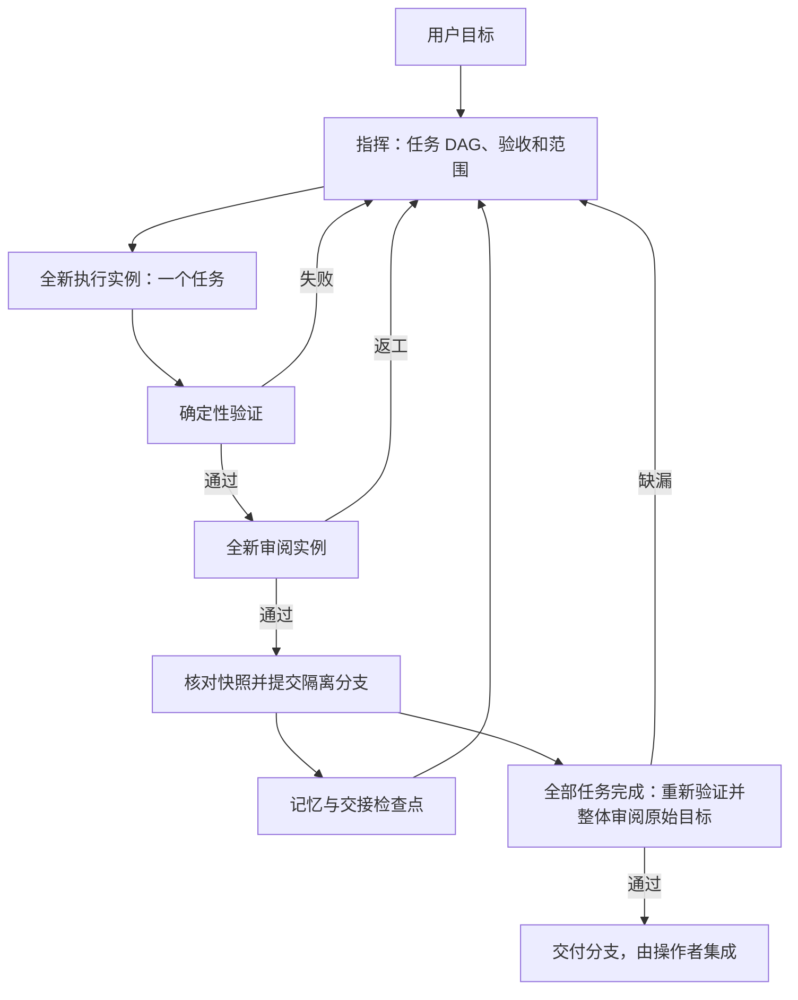

# Personal Harness

属于自己的多模型工程编排器。优先复用已登录的 Codex CLI 与 Claude Code，Python 3.11+，运行核心没有第三方 Python 依赖。当前为可运行的本地 CLI 首版，面向 macOS / Linux。

| 角色 | 默认模型 | 生命周期 |
| --- | --- | --- |
| 指挥 | `gpt-6-astra`，可切换 `claude-fable-5-1` | 通过持久任务台账延续决策，每次调用重新组装上下文 |
| 执行 | `claude-opus-5-5` | 一个任务或一次返工，一个新进程 |
| 审阅 | `gpt-6.1-sol` | 一次独立审阅，一个新进程 |

模型 ID 按配置原样使用；账号、模型权限或 CLI 故障直接报错，不自动换模型。每次调用都有新的进程和 `dispatch_id`，不恢复供应商会话、不启用原生子 agent、不自动合并。



## 先运行

在这个仓库目录中执行：

```bash
python3 -m harness doctor
python3 -m harness demo
python3 -m unittest discover -s tests -v
```

`doctor` 只检查配置中使用的 CLI 安装和登录，不请求模型；`demo` 用模拟 agent 跑真实 Git、测试、提交、记忆和交接流程，在临时目录留下可检查的结果。它不证明真实模型调用成功。

真实模型的最小联调会消耗你现有账号的额度：

```bash
python3 -m harness smoke
python3 -m harness smoke --commander fable
```

`smoke` 在临时 Git 仓库完成一个小函数，由真实指挥生成计划，再调用执行者、任务审阅者和整体审阅者，并运行真实测试。它不改动本仓库代码。

独立权限与工具检查也调用配置中的真实 Claude worker 模型、消耗账号额度并保留原始证据：

```bash
python3 -m harness.permission_smoke --config /path/to/harness.toml --repo /path/to/project
python3 -m harness.tool_smoke --config /path/to/harness.toml --repo /path/to/project
```

权限检查在 `.harness/permission-smoke/` 建立专用现场，关闭外部 MCP，不执行项目验证命令；它不证明完整命令白名单或 OS 隔离。参数、证据要求和结果边界见[独立真实工具检查](docs/recovery.md#独立真实工具检查)，已执行的检查见[验证记录](docs/validation.md)。

## 对自己的项目执行任务

1. 为目标项目准备 [harness.toml](harness.toml)，设置真正需要的 `verification.commands`，运行时显式传入 `--config`。每条命令是 argv 数组，不经 shell 解释，例如 `["uv", "run", "pytest"]` 或 `["npm", "test", "--", "--run"]`。依赖需要在 worktree 中可用；生成产物应已忽略或位于工作树外，验证期间出现未忽略的新文件也会触发快照门禁。
2. 目标项目必须有 Git 提交，且已跟踪文件与暂存区没有未提交修改。主检出的未跟踪文件只产生警告并保留原位；任务工作树从 HEAD 创建，不复制未跟踪或忽略文件。编排器不会替你 stash。当前不支持 submodule，索引存在 gitlink 时在创建 worktree 和派发模型前报错。
3. 在本 Harness 仓库目录运行：

```bash
python3 -m harness --config /absolute/path/harness.toml --repo /absolute/path/to/project run "修复分页边界错误，并补充必要的回归测试"
python3 -m harness --config /absolute/path/harness.toml --repo /absolute/path/to/project run "实现导出功能" --commander fable
```

未传入 `--config` 时使用本 Harness 仓库的默认配置，不会按 `--repo` 自动选择目标项目配置。`run` 启动时输出实际配置路径和验证命令。后续 `resume` 应使用同一份配置；共享资源路径相对于配置文件所在目录。

配置拒绝未知节和键，并指出完整路径。非 editable 安装不附带默认 `harness.toml` 与 `shared/`，执行任务需显式提供配置；`status`、`memory` 和 `cleanup-verification` 不依赖配置。运行事件和诊断写 stderr，`run`、`resume`、`demo` 的 stdout 保持单个 JSON 结果。

可用 `--plan /path/to/plan.json` 提供已有计划，格式见 [examples/plan.json](examples/plan.json)。输入在创建 run、分支和 worktree 前校验任务 ID、DAG、非空验收、范围和 skill。范围从仓库根目录匹配：`src/*` 只匹配直接子项，`src/**` 匹配所有层级，`**/*.py` 也匹配根目录文件；只有独立 `**` 路径段跨越 `/`。范围应覆盖必要测试与夹具。全仓库模式允许但会警告；`.git`、`.harness`、`.codex`、`.claude` 仍受保护。

任务的 `required_commands` 最多声明 32 条不同的完整 argv，表示执行前置条件，不授予权限。派发前与 `verification.commands`、`permissions.worker_commands` 精确比较；不接受前缀，`verification.setup_commands` 不授予 worker 能力。缺少授权时不启动 worker 或消耗其尝试，其他满足条件的就绪任务仍可继续；已有任务选择保持绑定。`status RUN` 显示 `missing_command_requirements`，追加精确授权后普通 `resume` 即可重检，无需环境更新。计划批准不增加权限，检查不证明命令存在、执行成功或验收通过。

模型计划的重复／超限声明保留结果并停止，普通恢复不重抽计划。显式修正与旧版兼容边界见[计划范围与命令前置条件](docs/recovery.md#计划范围与命令前置条件)及[阻塞出口](docs/recovery.md#阻塞状态与操作者出口)。

默认连续执行。需要先检查计划或分步执行时：

```bash
python3 -m harness --config /path/to/harness.toml --repo /path/to/project run "实现导出功能" --pause-after-plan
python3 -m harness --repo /path/to/project status RUN
python3 -m harness --config /path/to/harness.toml --repo /path/to/project resume RUN --approve-plan --step
python3 -m harness --config /path/to/harness.toml --repo /path/to/project resume RUN --step
```

`RUN` 替换为实际 run ID。`--pause-after-plan` 等待显式 `--approve-plan`，普通恢复不会批准。`--step` 最多接受一个任务后暂停，最后一个任务完成后仍执行整体验收。

所有更改在 `<目标项目>/.harness/worktrees/<run_id>` 的 `harness/<run_id>` 分支完成。每个通过检查和审阅的任务生成本地提交。成功输出分支和路径，便于查看 diff、merge 或 cherry-pick；最终集成由你操作。

## 验收与隔离

任务接受必须同时满足：合法 worker 结果声明完成、Git 绑定与 HEAD 未变、修改在允许范围内、所有验证成功、独立审阅批准且无 blocking findings、接受前文件快照仍一致。建议可以保留，`request_changes` 或任何阻断问题都不通过。审阅者读取实际 diff、验证日志和历轮问题的证据，不接收 worker 的私有推理；worker 自报完成不等于接受。

全部任务接受并提交后重新运行验证，由新的审阅实例对照原始目标、原始任务约束和整条分支 diff 验收。整体拒绝须经正常修复任务门禁，不能靠反复恢复重抽审阅结论。记忆在任务接受后写入，知识提案还须逐项获批。

返工时指挥可直接转再规划，缺少前置条件时补充任务，验收在当前边界内不可达时停止，无需先重复派发 worker。操作者接受风险不改变验收；停止后的部分交付与恢复出口见[验收不可达](docs/recovery.md#验收不可达)。

一条 run 按 DAG 串行执行，复用工作树和已接受代码。Git worktree 是任务隔离，不是操作系统安全沙箱；范围检查发生在接受前，忽略文件和外部服务副作用不在 Git 快照覆盖范围内。CLI、hooks、验证命令和 MCP 服务以当前用户权限运行。更强隔离需专用 OS 用户或容器。

需要验证交付提交不依赖 worker 留下的忽略文件时：

```toml
[verification]
commands = [["npm", "test", "--", "--run"]]
fresh_checkout = true
setup_commands = [["npm", "ci"]]
```

默认 `fresh_checkout = false`、`setup_commands = []`。开启后，仅整体验证改用目标仓库外的全新 detached worktree，顺序执行准备与验证；准备不得改变已跟踪文件或留下未忽略文件，也不授予 worker 权限。任务级验证仍在原工作树，依赖仍须可用。同一 run 不可改变这两项设置。

验证检出保留供检查，`abandon --remove-worktree` 不清理它们；失败后恢复及显式清理见[Git 现场与验证检出清理](docs/recovery.md#git-现场与验证检出清理)。该模式仍使用当前环境、Git 配置及声明的准备命令，不承诺容器级可复现性。忽略路径清单只是诊断，不校验目录内部内容，不能替代全新检出。

## 状态、恢复与清理

```bash
python3 -m harness --repo /path/to/project status
python3 -m harness --repo /path/to/project status RUN
python3 -m harness --repo /path/to/project status RUN --full
python3 -m harness --config /path/to/harness.toml --repo /path/to/project resume RUN
python3 -m harness --config /path/to/harness.toml --repo /path/to/project abandon RUN
python3 -m harness --repo /path/to/project cleanup-verification RUN
```

`status RUN` 显示任务、预算和最后错误首行，`--full` 查看完整台账。`resume` 使用保存的现场和全新 agent，不恢复供应商会话，也不清零累计预算。可增加上下文、超时、轮数、尝试／派发／再规划／最终验收上限和 `max_tasks`，或追加精确 worker argv；其余配置及共享资产必须一致。

同一快照上的已保存阶段可复用：验证中断只重跑验证，审阅调用故障只新派发 reviewer，接受 hook 失败只重试 hook。worker 返回与阶段保存之间仍有可能重复调用的中断窗口。代码变化使旧批准失效，进程未确认退出、HEAD／Git 绑定异常或证据损坏会停止；完整保存顺序见[恢复协议](docs/recovery.md)。

| 情况 | 常用出口 |
| --- | --- |
| 等待计划批准 | `resume RUN --approve-plan` |
| 精确命令未授权 | 追加配置后普通 `resume RUN` |
| 已保存 worker 环境阻断 | 修复条件后 `resume RUN --environment-update FILE` |
| 等待用户决定 | 从 status 取 request ID，`resume RUN --operator-decision FILE`；可重复参数一次回答多项 |
| 指挥明确停止 | `resume RUN --retry-stopped TASK_ID`，整体阶段用 `final` |
| 再规划需要额外范围 | `resume RUN --allow-scope 'config/**'`；停止状态另需显式重试 |
| 最终验证普通非零退出 | 正常修正规划；确认环境已修复时可显式 `resume RUN --reverify` |
| 可受控修正的非法结果 | `resume RUN --repair-invalid DISPATCH_ID` |
| 旧 dispatch 退出记录无法确认 | 人工核实后 `--confirm-exited DISPATCH_ID` |

这些入口沿用原预算、范围、权限和接受条件，不能通用地丢弃已返回结果或拒绝。选项互斥、资格与版本限制见[阻塞状态与操作者出口](docs/recovery.md#阻塞状态与操作者出口)。环境更新严格 JSON 示例见[环境更新](docs/recovery.md#环境更新)，决定输入格式见[可复用检查点与操作者决定](docs/recovery.md#可复用检查点与操作者决定版本-10)。检查点只说明声明的输入未变且未过期，不代替验证或审阅；操作者答复只允许对应问题继续，不增加命令权限。

`abandon RUN` 保留分支、工作树和证据并禁止恢复。可追加 `--remove-worktree` 移除干净工作树；任何未保存文件（含忽略文件）、隐藏索引标记、字节与 HEAD 不符或进程退出未知均阻止移除，不强制删除。清理错误列出阻塞路径，需先人工核对。

`cleanup-verification RUN` 默认预览，`--remove` 才移除符合门禁的验证检出，保留台账和证据。父 dispatch 退出不能证明 broker 命令子进程退出；核实后可用 `cleanup-verification RUN --confirm-exited DISPATCH_ID`，也支持已完成或放弃的 run。完整规则见[清理协议](docs/recovery.md#git-现场与验证检出清理)。

新台账版本为 11；未完成的 8／9／10 经预检后升级并保留预算与证据，7 及更早只能查看、不能直接恢复执行。已完成 run 的普通恢复返回保存结果；终态选项限制见[终态与版本兼容](docs/recovery.md#终态与版本兼容)。

## 共用 skills / MCP / hooks

共用源在 `shared/`，由运行时读取，避免为两个厂商维护两套业务规则：

| 文件 | 用途 |
| --- | --- |
| [shared/RULES.md](shared/RULES.md) | 所有角色的任务协议 |
| `shared/skills/*/SKILL.md` | 角色工作方式与可选业务技能 |
| [shared/mcp.json](shared/mcp.json) | 外部 MCP 服务的唯一配置源 |
| [shared/hooks.json](shared/hooks.json) | 确定性的编排生命周期 hooks |

角色 skill 自动注入一次；计划的 `skills` 选择额外技能，不需要时用 `[]`。其他技能先加载目录，再通过 `skill_read` 按需读取。旧计划引用角色 skill 仍合法且不会重复注入；不会自动安装整个 ECC 技能目录。

内置只读 `harness` MCP 向两种 CLI 提供记忆、技能、运行状态以及 `file_sha256`、`json_check`、`file_diff`。文件工具只读普通文件，相对路径锚定 run 工作树，绝对路径可读取外部证据；工具限制和 JSON 兼容语义见[接口参考](docs/design.md#精确命令-broker-与只读文件证据版本-11)。没有记忆写入工具。

worker 独有的 `harness_commands` MCP 提供 `list_commands` 和 `run_command({command_id})`，优先用它执行配置中的完整 argv。不能附加参数或覆盖 cwd、env，不经 shell 插值；命令 stdout/stderr、receipt 和子进程 journal 留在 dispatch 私有 `commands/`。工具的命令 ID 与两组配置逐项对应。

```toml
[permissions]
worker_commands = [["python3", "-m", "unittest", "tests.test_export", "-v"]]
```

字面 `*` 或换行由 broker 原样传递。管道或重定向须显式授权完整 `["/bin/sh", "-c", "固定脚本"]`；删除／移动须配置含具体路径的 `rm`／`mv` argv。不会自动组合命令、授权 `gh`／`ssh`／`curl` 前缀或跳过权限检查，不得用后台执行绕过 broker。必要命令被拒绝时 worker 应报告环境 blocker。当前 Codex 适配器只提供只读模式，配置 Codex worker 会提前报错。

外部 MCP 支持 stdio / HTTP 和按 `roles` 限制；指挥、审阅服务必须声明 `read_only = true`，由配置维护者核实。凭据只填写环境变量名称。示例见 [examples/mcp.json](examples/mcp.json)；OpenWiki 默认关闭，启用前需填真实路径并关闭 agent 写入能力。预检验证配置，不连接服务或证明凭据可用。

```bash
python3 -m harness sync --role worker
```

`sync` 生成 `.harness/generated/worker/claude.mcp.json` 和 `codex.mcp.toml`；正式 dispatch 使用各自配置，不覆盖用户 CLI 配置。Codex 使用 `--ignore-user-config`，依赖自定义 provider/base URL 的登录需先扩展适配器。个人原生 hooks／自动记忆、项目指令自动注入及只读角色的厂商差异见[共享资产兼容](docs/recovery.md#hooks-与共享资产兼容)。候选项目指令作为待审阅证据，不能改变目标、验收或权限。

生命周期 hooks 支持 `pre_agent`、`post_agent`、`pre_verify`、`post_verify`、`pre_accept`、`post_accept`、`context_prepared`、`on_error`：

```json
{"pre_accept": [{"argv": ["python3", "scripts/check_policy.py"], "timeout_seconds": 30}]}
```

脚本在配置所在目录运行，从 stdin 读 JSON 事件，用事件绝对路径定位目标项目；非零退出或超时阻止继续。默认空数组表示无额外策略。hooks 可因中断重复执行，外部副作用需可重复执行。事件字段、旧别名 `context_compacted`、接受后待办与共享资产摘要边界见[Hooks 与共享资产兼容](docs/recovery.md#hooks-与共享资产兼容)。它们不是厂商原生工具 hooks，运行时不截获所有工具调用。

## 记忆与上下文

SQLite 存在目标项目 `.harness/memory.sqlite3`，同一项目各 run 共享库，各自保留独立分支和工作树。记忆分为任务历史、获批知识和操作者事实；L0 标题、L1 摘要、L2 详情按相关性与时间检索，原始 diff、日志和结果按引用读取。任务历史摘要来自独立 reviewer，worker 只可提出待批准知识。

```bash
python3 -m harness --repo /path/to/project memory add \
  --key architecture.storage --title "数据库约定" \
  --text "项目使用 PostgreSQL，迁移通过 Alembic 管理。" \
  --source "docs/architecture.md"
python3 -m harness --repo /path/to/project memory search "数据库迁移" --level 1
python3 -m harness --repo /path/to/project memory read mem_实际ID
python3 -m harness --repo /path/to/project memory export > memory-backup.json
```

`memory add` 默认保存项目事实，`--run RUN` 保存仅用于该 run 的参考说明，查询也需相同 `--run`。key 在项目内全局唯一，版本替换须作用域一致，旧版本仍可 read/export。真正的继续／停止选择应使用 `--operator-decision`。所有记忆均为 `reference_only`，不授予权限或替代操作者决定。

自动任务历史与知识默认 TTL 为 180 天，可通过 `[memory]` 的 `task_ttl_days`／`knowledge_ttl_days` 调整，0 表示不过期；操作者事实默认不过期。来源变化会降权，放弃或来源无效的任务历史不自动召回。检索是本地词法排序，没有 embedding 或自动语义冲突合并。作用域、旧记录与只读 SQLite 行为见[记忆兼容参考](docs/recovery.md#记忆作用域与来源兼容)。

上下文采用结构化检查点、有界检索和原始证据引用，在任务边界写 `handoff.json`／`handoff.md`；每次指挥调用重新构建输入。默认 `context_chars = 100000` 是编排输入字符上限，不是 token 数；必要约束超限就停止，可选记忆按整条移除。CLI 内部上下文不在该预算内。

大量变更路径与恢复路径使用 SHA256 绑定的完整索引，按需检索，不重复塞进模型输入。相同清单共用索引，原始范围、验收、diff 与快照仍保留；索引缺失或损坏会阻止继续，不能靠截断路径绕过门禁。详见[上下文与诊断产物](docs/recovery.md#上下文与诊断产物)。

默认 `agent_timeout_seconds = 3600`、`claude_max_turns = 50`。超时是整次模型调用的墙钟时限；超时的 worker 消耗一次工作尝试，已写修改保留供恢复核对，持续产出不会自动延长时限。已有配置显式设置的超时保持原值，可在恢复前调大。完整输入和 `context-report.json` 保存在 dispatch 目录；容量预检、日志摘录与预算字段见[上下文与诊断产物](docs/recovery.md#上下文与诊断产物)。增大预算不保证任意长任务都能完成。

## 数据与排查

```text
<project>/.harness/
  memory.sqlite3
  generated/
  runs/<run_id>/
    state.json          # 台账、预算、进程和分支
    events.jsonl        # 追加事件
    handoff.json / handoff.md
    dispatches/<uuid>/  # 输入、schema、结果、CLI 日志、commands/
    verification/      # 命令、日志、diff、快照、checkout.json
    hooks/             # 生命周期日志
    plans/ / recovery/ # 计划版本、修订及未接受修改归档
    environment/       # 环境更新与只读前置检查
    decisions/         # 来源绑定的请求与答复
    checkpoints/       # 检查点和原始证据副本
  worktrees/<run_id>/   # 隔离分支中的代码
```

运行时只把 `/.harness/` 加入目标项目的本地 `.git/info/exclude`，不改已跟踪 `.gitignore`。`.harness/` 属于被忽略的私有运行目录，不要提交运行现场、凭据或生成 MCP 配置；日志可能包含代码与业务内容。离线开发验证产物集中到 `.harness/validation/<批次>/`，登记结果并被后续验证覆盖后可清理，当前 `.harness/refactor/` 不迁移；详见[验证记录](docs/validation.md)。

`status RUN --full` 的 `provider_usage` 及 `dispatch_finished` 事件记录供应商实际返回的用量，缺失用量不当作零，报告成本不等于实际账单。长进程每 60 秒提示仍在运行，实际超时独立生效。错误、中断、Git 提交与检查点之间的窗口见[恢复协议](docs/recovery.md)。

## 参考与边界

[设计取舍与参考来源](docs/design.md)记录 Orca、ECC、OpenWiki 的借鉴及厂商接口依据；实现是独立的小型编排核心，未复制这些项目源码或运行其安装脚本。当前没有接管 Orca、安装全部 ECC 插件或部署 OpenWiki 图数据库。

[验证记录](docs/validation.md)区分已执行的离线测试与真实模型联调；[恢复协议](docs/recovery.md)集中保存详细状态与兼容契约。后续并行需要每任务 worktree、依赖集成与冲突处理；当前先保证完整串行闭环和新会话边界。
