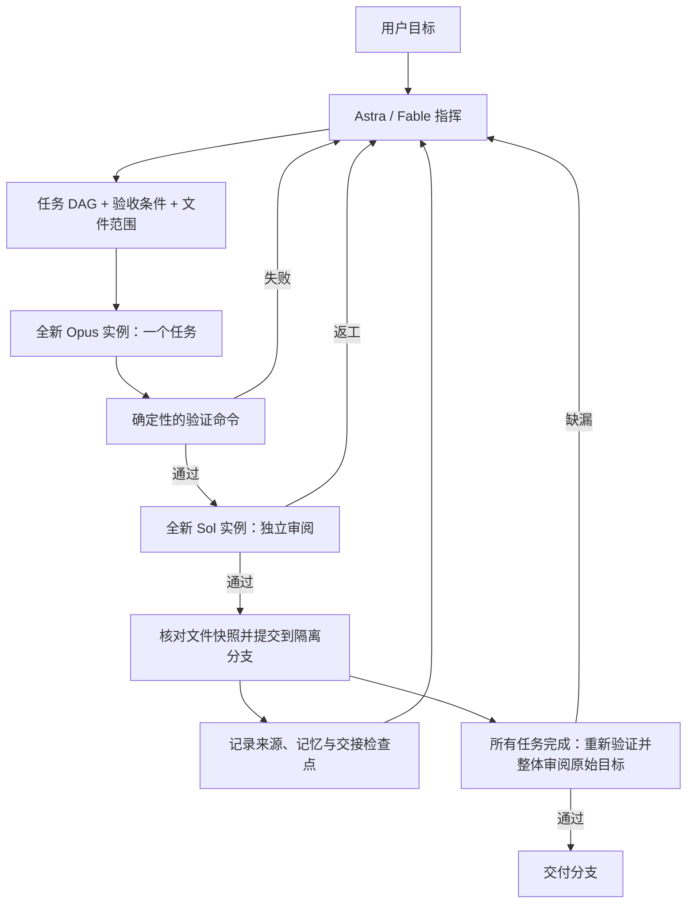

# Personal Harness

属于自己的多模型工程编排器。优先复用已登录的 Codex CLI 与 Claude Code，Python 3.11+，运行核心没有第三方 Python 依赖。当前为可运行的本地 CLI 首版，面向 macOS / Linux。

| 角色 | 默认模型 | 生命周期 |
| --- | --- | --- |
| 指挥 | `gpt-6-astra`，可切换 `claude-fable-5-1` | 通过持久任务台账延续决策，每次调用重新组装上下文 |
| 执行 | `claude-opus-5-5` | 一个任务或一次返工，一个新进程 |
| 审阅 | `gpt-6.1-sol` | 一次独立审阅，一个新进程 |



## 先运行

在这个仓库目录中执行：

```bash
python3 -m harness doctor
python3 -m harness demo
python3 -m unittest discover -s tests -v
```

`doctor` 只检查配置中使用的 CLI 安装和登录，不请求模型；`demo` 用模拟 agent 跑真实 Git、测试、提交、记忆和交接流程，在临时目录留下可检查的结果。它不证明真实模型调用成功。

真实模型的最小联调会消耗你现有账号的额度：

```bash
python3 -m harness smoke
# 可选：改由 Fable 指挥
python3 -m harness smoke --commander fable
```

`smoke` 在临时 Git 仓库完成一个小函数，由真实指挥生成计划，再调用执行者、任务审阅者和整体审阅者，并运行真实测试。它不改动本仓库代码。

另有独立的真实 Claude 权限检查，同样消耗账号额度，并使用配置中的 worker 模型 ID：

```bash
python3 -m harness.permission_smoke --config /path/to/harness.toml --repo /path/to/project
```

它在 `.harness/permission-smoke/` 创建专用测试仓库与工作树，保留报告和供应商原始输出；`--repo` 仅指定私有现场的存放位置。检查包含工作树内读写、精确命令、额外参数、工作树外读写及 `.git` 修改。通过标准要求实际工具调用、工具结果、对应的 `permission_denials` 和文件内容一致，模型自称“已拒绝”不算证据。工作树外读取按当前适配器授权应当成功。检查使用专用命令并关闭外部 MCP，不运行项目验证命令；默认超时 180 秒、最多 16 轮、预算参数为 1 美元，可用 `--timeout`、`--max-turns`、`--max-budget-usd` 调整。结果只覆盖这组测试与实际 CLI 版本，不证明完整的命令白名单或操作系统隔离。

## 对自己的项目执行任务

1. 为目标项目准备配置文件，设置真正需要的 `verification.commands`，并在运行时显式传入 `--config`。每条命令是 argv 数组，不经 shell 解释。例如 Python 项目可以使用 `["uv", "run", "pytest"]`，Node 项目可以使用 `["npm", "test", "--", "--run"]`。依赖需要在 worktree 中可用；覆盖率、构建等生成产物应配置到已忽略或工作树之外的位置，验证期间出现未忽略的新文件也会触发快照门禁。
2. 目标项目必须有 Git 提交，且已跟踪文件与暂存区没有未提交修改。主检出的未跟踪文件只产生警告，保留原位，不复制到从 HEAD 创建的任务工作树；忽略文件也不会自动复制。编排器不会替你 stash 尚未提交的工作。当前不支持 submodule；索引中存在 gitlink 时会在创建 worktree 和派发模型之前报错。
3. 在本 Harness 仓库目录运行：

```bash
python3 -m harness --config /absolute/path/harness.toml --repo /absolute/path/to/project run "修复分页边界错误，并补充必要的回归测试"
python3 -m harness --config /absolute/path/harness.toml --repo /absolute/path/to/project run "实现导出功能" --commander fable
```

未传入 `--config` 时使用本 Harness 仓库的默认配置，不会按 `--repo` 自动选择目标项目配置。`run` 启动时输出实际配置路径和验证命令。后续 `resume` 应使用同一份配置；共享资源路径相对于该配置文件所在目录，请使用正确的相对或绝对资源路径。

配置拒绝未知节和键，并指出完整路径，避免拼写错误使预算静默回落到默认值。非 editable 安装不附带默认 `harness.toml` 与 `shared/`，执行任务时需显式提供配置；`status`、`memory` 和 `cleanup-verification` 不依赖配置文件。运行事件和诊断写 stderr，`run`、`resume`、`demo` 的 stdout 保持单个 JSON 结果，便于脚本读取。

可用 `--plan /path/to/plan.json` 提供已有计划，格式见 [examples/plan.json](examples/plan.json)。计划会检查任务 ID、依赖环、非空验收条件、文件范围及引用的 skill 是否存在。`allowed_paths` 从仓库根目录匹配：`src/*` 只匹配直接子项，`src/**` 匹配所有层级，`**/*.py` 也可匹配根目录 Python 文件；只有独立的 `**` 路径段跨越 `/`。显式指向 `.git`、`.harness`、`.codex`、`.claude` 的范围在规划时拒绝，实际变更仍会独立检查这些受保护路径。唯一就绪任务在首次尝试且没有反馈时直接使用完整任务简报派发；存在选择或返工反馈时才调用指挥。

用户提供的计划在创建 run 目录、分支和 worktree 前完成校验，输入错误可直接修正后重试。任务范围应覆盖实现所需的具体测试与夹具，前置工作应有明确归属与依赖顺序。`**`、`**/*` 等常见全仓库模式仍允许使用，但登记计划时会向 stderr 提示并记录 `broad_scope_warning`；这类范围不限制普通项目文件，受保护路径门禁仍生效。

默认连续执行。需要先检查计划或分步执行时，可显式选择：

```bash
python3 -m harness --config /path/to/harness.toml --repo /path/to/project run "实现导出功能" --pause-after-plan
python3 -m harness --repo /path/to/project status run_实际ID
python3 -m harness --config /path/to/harness.toml --repo /path/to/project resume run_实际ID --approve-plan --step
python3 -m harness --config /path/to/harness.toml --repo /path/to/project resume run_实际ID --step
```

`--pause-after-plan` 将计划保存到运行目录并等待 `--approve-plan`；普通 `resume` 不会替你批准。`--step` 最多接受一个任务后暂停；最后一个任务完成后仍执行整体验收。

所有更改在 `<目标项目>/.harness/worktrees/<run_id>` 的 `harness/<run_id>` 分支完成。每个通过检查和审阅的任务生成本地提交。成功输出分支和路径，便于查看 diff、merge 或 cherry-pick。最终集成由你操作。

创建工作树时记录实际 Git 管理目录、公共目录、分支及双向链接文件的摘要。运行时的工作树 Git 命令显式固定管理目录和工作目录，排除环境中的 Git 重定向参数，并在操作前后检查绑定；改写 `.git`、切换分支或改变管理目录链接会停止运行。恢复、接受提交、再规划归档、记忆来源核验和移除工作树都遵守该绑定。Claude 内置编辑权限另拒绝工作树 `.git`，但脚本仍依靠运行时门禁检查。

需要验证交付提交不依赖 worker 留下的忽略文件时，可显式配置：

```toml
[verification]
commands = [["npm", "test", "--", "--run"]]
fresh_checkout = true
setup_commands = [["npm", "ci"]]
```

开启后，整体验证在目标仓库之外的全新 detached worktree 中执行，先按精确 argv 顺序准备依赖，再运行验证。准备命令仅由运行时执行，不自动授予 worker 命令权限；不得修改已跟踪文件或留下未忽略的新文件。任务级验证仍在原 run 工作树中执行，因此它所需的依赖仍应提前可用。默认 `fresh_checkout = false`，`setup_commands = []`；同一 run 恢复时这两项不可改变。

准备失败或中断保留日志，普通 resume 在另一个全新检出重试当前最终尝试，不重复 worker；已经完成验证而仅审阅失败时复用原验证证据。新检出位于系统临时目录的私有 `harness-verify-*/.harness/checkout`，路径、绑定和准备结果记入验证目录的 `checkout.json`，保留供检查，不由 `abandon --remove-worktree` 自动清理。临时目录若位于目标仓库内则拒绝使用。此模式隔离工作树遗留文件及主仓库父目录依赖，仍使用当前进程环境、Git 配置和操作者声明的准备命令，不承诺容器级可复现性。

可以显式查看和清理这些验证检出：

```bash
python3 -m harness --repo /path/to/project cleanup-verification run_实际ID
python3 -m harness --repo /path/to/project cleanup-verification run_实际ID --remove
```

默认只返回各检出的可清理状态；`--remove` 在运行锁内确认旧进程退出、路径归属、Git 绑定及原验证提交后逐项移除，保留运行台账、diff、日志和 `checkout.json`，另写清理记录。已跟踪修改、未跟踪或忽略文件均阻止清理，需要先人工核对。目录已缺失时，仅在原绑定仍可核验的情况下注销该精确路径，不执行全仓库 prune。该命令兼容版本 7、8、9 的台账，不加载配置或调用模型。

旧 dispatch 没有可确认的退出记录时，清理与恢复均停止；缺少 pgid 不能证明进程未启动。核实退出后可执行 `cleanup-verification RUN --confirm-exited DISPATCH_ID`，可重复指定 ID，也可与 `--remove` 合用。此确认入口支持已完成或已放弃的 run，先保存审计事件，再更新指定 dispatch 的确认，不改变 run 状态或放松文件清理门禁。未指定确认时，预览不改运行台账。

运行开始、worker 返回及验证结束还保存被忽略路径的清单和相对初始状态的增减，变化写入事件；审阅输入带清单产物引用。目录折叠显示，此诊断不哈希忽略文件内容，也不能发现既有依赖目录内部的修改，不能替代全新检出验证。

```bash
python3 -m harness --repo /path/to/project status
python3 -m harness --repo /path/to/project status run_实际ID
python3 -m harness --repo /path/to/project status run_实际ID --full
python3 -m harness --config /path/to/harness.toml --repo /path/to/project resume run_实际ID
```

`status <run_id>` 默认显示状态、任务、预算和最后错误首行；`--full` 输出完整台账。需要结束未完成运行时使用 `abandon <run_id>`，保留分支、工作树和证据，并禁止继续恢复。可追加 `--remove-worktree` 移除该 run 的干净工作树；进程仍存活、HEAD 不符或有任何未保存文件（包括忽略文件）时拒绝移除，不使用强制删除。

移除前还独立核对已跟踪文件的字节与 HEAD，并拒绝 `assume-unchanged`、`skip-worktree` 标记。换行转换或 clean/smudge 过滤导致工作树字节不同，也会保守拒绝；此时可只放弃运行并保留工作树。

未跟踪文件（包括忽略文件）导致清理失败时，错误列出前 10 个阻塞路径及剩余数量，长路径作有界显示；这些文件仍需人工核对，不自动删除。

`resume` 使用已有台账、代码现场和新的 agent 继续，不恢复供应商会话。任务、总 worker、模型派发、有效再规划和最终验收次数均不会因恢复而清零。可以调大 `context_chars`、两种超时、`claude_max_turns`、`max_attempts`、`max_total_attempts`、`max_agent_dispatches`、`max_replans`、`max_final_attempts` 和 `max_tasks` 后恢复；也可以在 `permissions.worker_commands` 中追加精确 argv，但不能删除或修改已有授权。变更写入事件，其余配置和共享资源必须一致。旧进程组仍存活、无法确认其退出，或 Git HEAD 与检查点不一致时停止恢复。账号授权、模型权限和其他 CLI 故障直接报错，不自动换模型或进行通用瞬时故障重试。

如果已人工核实旧 dispatch 退出，但记录的进程组 ID 被无关进程复用，可使用 `resume <run_id> --confirm-exited <dispatch_id>`；`abandon` 支持相同选项，多个 ID 可重复指定。该确认只影响精确指定的 dispatch，记录当时的进程组存活探测和组长进程信息，不终止无关进程，也不跳过 HEAD、文件或接受门禁。未知 ID 在任何确认写入前拒绝。

worker 完成后保存验证阶段；验证通过后保存待审阅阶段及快照、diff、验证证据。恢复时快照一致，验证中断只重跑验证，审阅调用故障只新派发 reviewer，均不重复消耗 worker 额度。文件变化使旧阶段失效，必须重新执行任务。重跑验证保留独立日志。越界文件留在工作树时，恢复先停止并提示清理，不再派发 worker 或扣除尝试。

上述复用从阶段保存成功后开始。worker 结果返回到阶段保存之间中断，仍可能重新调度并重复 worker 尝试；编辑保留，但该窗口可能没有故障来源记录，详见[恢复协议](docs/recovery.md)。加载恢复状态会先核对可选对象类型、任务／再规划互斥、派发引用，以及待验证／审阅、待接受、接受后待办和当前任务的引用是否指向现有任务；不一致时保留台账和现场并停止，不派发或写入记忆。

整体验收也保存验证和审阅阶段；中断继续同一次最终尝试。最终验证全部失败项都是超时时，修复环境或增加超时后普通 `resume` 可重验；普通非零退出进入修正规划，操作者确认需要重验同一快照时使用 `resume <run_id> --reverify`。该授权仅对本次恢复的首次整体验收生效；即使首次处理的是新快照、未完成阶段或超时后的重验，也不会延续到本次恢复中后续产生的失败。重验消耗新的最终尝试，并保留失败证据；该选项仅在整体验收预算允许重验时取消尚未返回指挥结果的验证失败修正规划，不能丢弃已返回的指挥结果、跳过已校验修订或重抽模型拒绝结论。预算耗尽时，被拒绝的 `--reverify` 保留待再规划意图，增加预算后普通 `resume` 可继续修正规划，也可显式 `--reverify` 重验。

新运行台账为版本 9，保存操作者环境更新及检查证据。版本 8 仍可普通恢复；首次接受环境更新时升级为 9，原预算与历史保留。版本 7 及更早台账可通过 `status` 查看，不能直接恢复执行；请用对应旧版本完成旧 run，或从核对后的代码开始新 run。列出状态时，损坏或缺失的台账会产生诊断，不会阻止查看其他运行。当前版本已完成的 run 在普通 `resume` 时直接返回保存结果，不再比较执行配置和共享资产与运行时保存值，也不派发或记账；CLI 初始化仍需能加载当前配置与 hooks。已完成 run 的 `resume` 拒绝 `--confirm-exited`、`--repair-invalid`、`--allow-scope` 和 `--environment-update`；`--reverify`、`--retry-stopped`、`--approve-plan` 和 `--step` 不生效，仍返回保存结果，不表示执行了所请求的恢复操作。

`status` 的 `worker_outcomes` 区分 worker 自报完成、任务阻断、环境阻断、运行故障及未知结果，不代表任务已接受。`last_environment_blocker` 保留最近环境阻断来源与更新诊断；后续调用开始后标记 stale，属于历史证据，不表示当前仍停在同一环境阻断或仍可提交更新。

任务因缺少前置工作而返回 `blocker_kind=task` 时，指挥可进行有限再规划；权限、工具、账号或服务问题使用 `environment` 并停止。指挥仅返回 `new_tasks` 和 `updates` 增量操作，运行时保留已有任务的 ID、验收条件、文件范围及依赖；更新只能改进未接受任务的描述并增加依赖，已接受任务完全不变。新任务必须复用既有范围模式或操作者显式批准的额外模式。已校验的修订先保存，再归档未接受修改并恢复到最后接受的提交；归档中断后的恢复继续应用该修订，不再请求模型或增加再规划次数。

worker 因环境受阻后，可用结构化更新说明已修复的环境事实：

```bash
python3 -m harness --config /path/to/harness.toml --repo /path/to/project resume run_实际ID --environment-update /absolute/path/update.json --step
```

```json
{
  "schema_version": 1,
  "task_id": "task_id_from_status",
  "blocker_dispatch_id": "worker_dispatch_id_from_status",
  "summary": "依赖已在当前运行工作树中准备好；请重新检查后继续原任务。",
  "checks": [
    {"kind": "path", "path": "/absolute/path/to/dependencies", "path_type": "directory"},
    {"kind": "executable", "name": "python3"}
  ]
}
```

输入文件最多 64 KiB，每个 run 最多保存 32 条更新；严格拒绝未知字段。`summary` 必须非空且不超过 4,000 字符；`checks` 可省略，默认为空数组，最多 16 项。检查只允许三种形式：`path` 的绝对路径及 `path_type=file|directory|any`；`executable` 的可执行文件名或绝对路径；`worker_command` 的精确 `argv` 数组。最后一种只检查命令已在当前 `permissions.worker_commands` 或 `verification.commands` 中声明，不执行命令，也不新增授权。未声明的命令作为失败前置条件保留更新与报告；操作者在配置中追加精确授权后，可普通 resume 重检。全部检查只读，不启动子进程，不保证真实 CLI 或服务调用成功；仅需说明操作者事实时可省略检查。

更新仅在当前 worker 的环境 blocker 已保存、来源仍有效且没有待处理派发指令、receipt、验证／审阅／接受／再规划阶段或活动修正时接受。任务 ID 与 blocker dispatch ID 必须匹配当前来源。首次后续模型调用前中断，即使状态为 interrupted 或遗留 running，满足这些条件仍可提交更新；已开始的指挥调用即使失败，也使旧来源过期。已完成或已放弃的 run 拒绝更新；该选项与 `--reverify`、`--retry-stopped`、`--allow-scope`、`--repair-invalid` 互斥，可与 `--step` 合用。

输入复制到 `.harness/` 私有产物并绑定摘要；原输入文件随后可移走。同一 blocker 来源、尚无后续模型调用时，重复提交相同更新不会重复登记。保存中断可能使审计事件以同一稳定更新 ID 重复出现，台账仍只登记一条引用。更新按顺序进入后续指挥、worker 和 reviewer 的必要上下文，包括整体审阅容量估计；各任务最新更新的最近检查报告经摘要核验后作为 `environment_observations` 一并提供。它是操作者对匹配任务环境事实的更新，可替代过时环境假设，不改变目标、文件范围、验收、工具权限或记忆所有权，也不是完成证据。更新登记后不可撤回，其序列化内容持续计入必要上下文；合法输入也可能超过默认预算，此时需增大 `context_chars` 后恢复。

同一任务最新更新的 checks 替代旧检查列表，所有历史声明仍按序保留。选择前只预检已有的当前任务，不检查全部 ready 任务；选中的任务在每次 worker 尝试（含格式修正）前重检，所有报告保留。因此当前任务的一次普通尝试可能记录选择前和派发前两份报告。检查失败不启动本次 worker，也不消耗其尝试或派发预算；当前任务为空时，指挥选择可能已消耗派发预算，选定指令会保存供恢复复用。worker 返回后的验证和审阅不重跑这些前置检查，仍按原门禁独立验收。所有新调用使用新进程、新 dispatch，累计预算不清零；既有 receipt 与批准不能借更新重抽或复用到新候选。

确需新增前置文件时，可在待再规划阶段显式扩展新任务可用的范围：

```bash
python3 -m harness --config /path/to/harness.toml --repo /path/to/project resume run_实际ID --allow-scope 'config/**' --allow-scope 'tests/**'
```

`--allow-scope` 可重复指定，只接受合法且不显式指向受保护根路径的模式，写入独立的 `approved_scope` 和审计事件。它仅用于尚未校验的待再规划或已停止的再规划，不改变原任务的范围与验收，也不增加预算。已返回但因新增范围受阻的修订会重新校验同一 receipt；不会为此重抽指挥结果。若指挥已明确 stop，还须显式加 `--retry-stopped <task_id|final>` 才会重新请求规划；单独扩展范围保留停止状态。

再规划意图在所有预算检查之前保存。最后一次 worker 尝试报告 task blocker 时仍会停在预算门禁；将对应上限增加 1 后，恢复直接请求再规划，无需先重复执行 worker。总尝试或再规划预算耗尽也遵循同一恢复路径。

指挥的计划、再规划和任务选择也在派发前保存 receipt，绑定原请求、dispatch、候选快照和结果位置。结果已落盘时，普通恢复继续检查同一结果及其 `post_agent` hook，不重新抽取指挥结论；已经绑定摘要的结果缺失、篡改或硬校验错误保留阻断；尚未返回结果的调用仍可人工恢复。hook 重试使用独立日志。receipt 与计划登记、再规划停止或待执行指令一起消费；局部准备失败保留已选指令，真正启动 worker 才消费它。自动格式修正与以下显式语义修正分别受持久额度约束。

对于身份、结构与当前快照均正确的部分非法结果，可以指定其尚未消费的 dispatch ID 请求一次受控修正：

```bash
python3 -m harness --config /path/to/harness.toml --repo /path/to/project resume run_实际ID --repair-invalid DISPATCH_ID
```

适用对象是语义非法的指挥计划／`revise`，以及没有 blocking finding、但存在重复 finding ID 或越界记忆批准的 `approve`。自动格式修正额度耗尽后，指挥任务选择的指令、`revise` 的原因文本，以及无 blocking finding 的 `approve` 的可变格式字段，也可请求这一次显式修正。每个角色／调用类型／任务在整个 run 内最多授权一次，语义和格式修正共用此额度。原结果文件与派发输入保留，`invalid_repairs` 保存原 receipt、内容摘要和快照依据；修正使用新进程、新 dispatch，继续消耗累计派发预算。

指挥任务选择使用固定任务身份 `dispatching`，再规划使用 `replanning`。这两种调用类型各自在整个 run 内共享一次自动格式修正额度和一次显式修正额度，不按被选择的工程任务、worker 尝试或再规划轮次重置。额度耗尽后不能通过普通恢复重新抽取指挥结果。

审阅修正必须保留最初 verdict、全部 finding 内容与顺序，以及原先已批准的合法记忆 key；只可修正重复或非法 ID、摘要、去重 key，并在语义修正中删除不属于提案的 key。格式耗尽后的修正同时绑定最初结果和失败修正结果；指挥格式修正固定最初选择的任务或修订操作，只能修正对应的指令或原因文本。旧 v8 指挥格式修正若缺少最初结果的已绑定摘要，不补造依据；普通恢复和显式修正均停止，可保留证据后 `abandon`。已有摘要的旧 reviewer 守卫仍可按上述条件恢复。

该选项不能处理身份／结构错误、stop、拒绝或 blocking 审阅、改变原结论的失败修正、不可改写的超大 finding，也不能绕过合法结果的 hook 失败。修正结果已返回后不会再次重抽，也不另获自动格式修正额度；尚未返回结果的 CLI 故障可普通 `resume` 继续，仍受预算限制，完成或待处理的修正守卫都会保留。`--repair-invalid` 不能与 `--reverify`、`--retry-stopped` 或 `--allow-scope` 同时使用。

指挥明确 `stop` 后保存停止原因和原规划请求，普通 `resume` 不派发模型。操作者决定重试时使用 `resume <run_id> --retry-stopped <task_id>`，整体验收的停止使用 `--retry-stopped final`。该选项重新请求规划，保留原停止证据，仍消耗累计再规划与派发预算。恢复未完成的 run 时，`--retry-stopped` 与 `--reverify` 互斥，合用会在台账和事件写入前报错。整体拒绝后，若修正任务接受了空 diff，运行时保留原拒绝并再次请求受预算约束的修正规划，不对同一快照重抽审阅。

结构与停止语义合法、但原因空白或超长的 stop 同样持久停止并计入再规划次数，原文和格式错误均保留。整体验证以非零退出失败后，空 diff 修正也会直接返回再规划；只有操作者明确使用 `--reverify` 才对未改变的失败快照重验。

`max_attempts` 是每任务累计上限，`max_total_attempts` 是整个 run 的 worker 上限。`max_replans` 计入通过完整校验的指挥再规划结果（包括明确停止），请求故障不扣除它；独立的 `max_agent_dispatches` 默认 200，限制所有角色的模型调用，包括失败和格式修正调用。`max_final_attempts` 默认 3，限制整体验证与审阅尝试；未完成阶段恢复复用当前尝试，重新验证已失败的最终检查则消耗新尝试。达到上限不会通过改名刷新预算。

worker 尝试与模型派发在上下文、派发前 hook、快照及预算检查成功后，调用后端前一起持久化。本地准备失败不消耗这些额度；后端调用失败仍计数。格式修正走同一个计数入口。

## “一个 agent 只做一件事”如何落实

- 每次调用生成唯一 `dispatch_id`，返回结果必须同时匹配它和 `task_id`。
- 输入包的 `output_constraints` 从本地契约生成，列出长度、数量、非空、唯一性及标识符格式限制；审阅还列出 finding ID 唯一、blocking 必须有证据且不能是偏好、批准记忆 key 属于当前提案等约束，无提案时批准数组必须为空。仅格式限制失败时，每个角色／调用类型／任务组合在整个 run 内最多自动修复一次，不因新尝试或新快照恢复额度；指挥任务选择和再规划使用上述固定身份，各自在整个 run 共用额度。修正使用新进程和新 dispatch，worker 修复计入任务及总尝试预算。格式修正状态独立保存，不混入其他角色的任务反馈。计划的现有格式边界由规划校验作为硬错误拒绝。已报告 blocker 的 worker 不自动重派；reviewer 修复不能改变原结论、findings 或证据，原始修正依据绑定内容摘要。非法结果不能用于接受；可明确归属的语义非法拒绝按下述独立状态进入返工，其余硬错误停止。
- Claude 使用 `--no-session-persistence`，Codex 使用 `--ephemeral`，没有 resume/continue。
- 禁用原生子 agent；指挥通过结构化计划交给调度器启动执行者。
- 返工使用新进程，得到同一任务、验收条件和必要的失败反馈。
- 审阅者收到任务、实际 diff、验证日志和历轮审阅问题的证据引用，不注入执行者的私有推理。记忆提案作为待独立核实的数据传入。
- 审阅派发前持久化结果接收位置和原 dispatch 身份；结果落盘后即使尚未校验就中断，恢复仍处理该结果。用于接受的结果必须通过身份、结构、语义、文件快照和 hook 检查；已返回的拒绝不能通过故障恢复重新抽取。格式修正的 CLI 故障保留原结论，只有实际违反原结论时才标记修正守卫失败。
- 身份、结构和快照有效，且含 `request_changes` 或 blocking finding 的首次审阅，若语义非法、finding 不可变字段违反格式限制，或仅可变字段格式错误但该身份的自动格式修正额度已用，保存为 `invalid_rejected`：保留原始结果、摘要、dispatch、校验错误及全部 findings，仍执行 `post_agent` 门禁，然后进入任务返工或整体修正规划。它不构成合法审阅，不批准记忆或代码。整体同一快照不能重新抽取 reviewer，空 diff 修正继续走有界再规划。自动或显式修正中的非法结果不适用此出口；旧拒绝型 `exhausted`／`unrepairable` 守卫不自动转换。
- 一条 run 按 DAG 串行执行，复用该 run 的工作树和已经通过审阅的代码；不复用执行者的模型会话。
- 任务接受由“检查通过 + 审阅通过 + 文件快照未变”决定。结构化 findings 区分阻断问题与建议；建议可以保留，`request_changes` 或任何阻断问题都不通过。
- 全部任务接受并提交后重新运行验证，由新的审阅实例对照原始目标、原始任务约束和整条分支 diff 验收。任务验证发生在接受提交之前，整体验证覆盖提交后的状态。整体拒绝后须经新修复任务通过门禁，不能靠反复恢复抽取新的审阅结论。
- 记忆写入只发生在任务接受之后；项目知识还需审阅者单独批准具体提案。

这是任务和会话层面的隔离。Git worktree 不是操作系统安全沙箱；文件范围检查是接受前的检查，不能保证恶意进程无法触碰同一用户可访问的其他文件。忽略文件、外部服务副作用不在 Git 快照覆盖范围内。

## 共用 skills / MCP / hooks

共用源在 `shared/`，由运行时读取，避免为两个厂商维护两套业务规则：

| 文件 | 用途 |
| --- | --- |
| `shared/RULES.md` | 所有角色的任务协议 |
| `shared/skills/*/SKILL.md` | 指挥、执行、审阅的工作方式；可增加业务技能 |
| `shared/mcp.json` | 外部 MCP 服务的唯一配置源 |
| `shared/hooks.json` | 确定性的编排生命周期 hooks |

当前角色 skill 直接注入；其他技能先加载目录，再通过内置 MCP `skill_read` 按需读取。任务计划中的 `skills` 可显式选择需要注入的技能。这里没有自动安装整个 ECC 技能目录。

内置 stdio MCP 在两种 CLI 中提供相同工具：

- `memory_search` / `memory_read`：项目记忆与来源。
- `skill_list` / `skill_read`：共用技能。
- `run_status`：当前目标与已接受任务。

`shared/mcp.json` 支持 stdio 与 HTTP。外部服务可按 `roles` 限定可见性；指挥和审阅服务必须声明 `read_only = true`，该声明由配置维护者负责核实。外部服务需要的凭据只填写环境变量名称。完整示例见 [examples/mcp.json](examples/mcp.json)，其中 OpenWiki 默认关闭，需要填入真实路径，并确保它没有开启 agent 写入能力。

创建 run 前校验所有角色可见且已启用的 MCP 服务配置，缺少 `transport`、stdio 的 `command` 或 HTTP 的 `url` 等错误会指出具体服务与字段。派发前再次校验当前角色的配置，本地配置错误不消耗 worker 或模型派发次数；关闭的示例服务可以保留未填写的连接字段。此预检不连接服务，也不证明凭据或服务可用。

```bash
python3 -m harness sync --role worker
```

这会生成 `.harness/generated/worker/claude.mcp.json` 和 `codex.mcp.toml`，供检查或手动使用；每次正式 dispatch 也会生成并传入自己的 MCP 配置。不会覆盖 `~/.claude` 或 `~/.codex` 的配置。Codex 调用使用 `--ignore-user-config` 保留登录凭据并减少个人配置干扰；如果你的登录依赖自定义 provider/base URL，当前适配器需要先显式扩展后才能复用该配置。

统一 hooks 是**编排生命周期 hooks**，覆盖 `pre_agent`、`post_agent`、`pre_verify`、`post_verify`、`pre_accept`、`post_accept`、`context_prepared`、`on_error`。例如：

```json
{
  "pre_accept": [
    {"argv": ["python3", "scripts/check_policy.py"], "timeout_seconds": 30}
  ]
}
```

脚本工作目录是配置所在目录，从 stdin 读取 JSON 事件，非零退出码或超时阻止继续。全部事件、argv 和正有限超时值在执行任何脚本前校验。通过事件中的路径定位目标项目。默认空数组表示没有额外策略。`context_prepared` 表示已组装有界输入；旧名 `context_compacted` 仍可单独配置作为别名，不能与新名同时配置非空脚本。它们与厂商原生的 `PreToolUse`、`PostToolUse` 不是同一层；运行时不截获所有原生工具调用。生成的调用会关闭个人原生 hooks/自动记忆，避免重复采集；企业管理配置可能仍有更高优先级。

所有 hook 事件都有 `run_id`、`repo`（目标仓库）、`worktree`（该事件的工作树）和 `run_dir`（运行证据目录），路径为绝对路径。全新检出的 `pre_verify`／`post_verify` 使用实际验证目录作为 `worktree`，另以 `source_worktree` 指向原 run 工作树；其他事件默认使用 run 工作树。

`post_agent` 接收已通过结果校验的调用，以及明确保留为 `invalid_rejected` 的审阅。其他非法结果在调用该 hook 前停止。“至少一次”指已进入 hook 门禁后的重试语义，不要求每个非法模型输出也触发 `post_agent`。

`pre_accept` 前保存已通过审阅的快照摘要和待接受状态。hook 失败会保存错误及日志引用；恢复时若快照不变，只重试该 hook，不重派该任务的 worker/reviewer。若文件已改变，旧审阅失效，必须重新执行任务、验证和独立审阅。每次 `pre_accept` 尝试使用独立日志目录。

`post_accept` 失败时保留已接受提交及待完成的 hook；恢复会先重试该 hook，成功前不能执行下一个任务或完成 run。hook 在成功后、检查点写入前中断时可能再次执行，需要将外部副作用写成可重复执行的操作。

`post_accept` 与 `on_error` 的每次执行也使用独立日志目录，恢复成功不会覆盖此前的失败输出。

任务记忆、获批知识提案及接受事件也有持久待办，在 `post_accept` 之前完成。SQLite 故障后恢复补写；稳定操作 ID 与内容摘要防止写入成功后中断造成重复版本，接受事件使用稳定 ID 去重。任务记忆只保存有界摘要和完整审阅产物引用。恢复补完一项待接受后续工作也计入 `--step` 的一个任务边界。

共享资产摘要按规则、skill 名称、MCP 和 hooks 的逻辑身份及内容计算，字节一致的 Harness 安装可以搬迁；目标项目与运行状态路径仍须保持一致。摘要不会递归追踪任意 hook 命令引用的脚本或依赖。操作者仍需保证这些外部内容在恢复时保持一致。

Claude worker 通过锚定在工作树真实路径的 `Edit(//.../**)` 规则允许内置 Edit、Write 工具写入，路径中的模式字符按字面转义；同时允许读取工具、部分读取命令和配置的验证命令。该规则不约束验证脚本或其他子进程自行读写文件。Claude 指挥与审阅角色也可使用受限的 Git 查询命令；输入包列出可用命令示例。额外的 worker 命令通过配置声明为完整 argv：

```toml
[permissions]
worker_commands = [["python3", "-m", "unittest", "tests.test_export", "-v"]]
```

额外命令不接受 `*` 或换行。需要删除或移动文件时，可显式配置包含具体路径的 `rm` / `mv` argv；默认不授予这些命令。验证 argv 中的字面 `*` 仍可由确定性验证器执行，但不转成 Bash 授权，以免被 CLI 解释为权限通配符。不使用跳过所有权限检查的参数；CLI 自身仍可能允许内建只读命令，这些授权不是操作系统沙箱。必要命令被拒绝时，worker 应报告环境 blocker。当前 Codex 适配器只提供只读模式，因此配置 Codex worker 会提前报错。Codex 只读角色设置 `project_doc_max_bytes=0`，关闭项目指令文件的自动注入；Claude 使用 `--setting-sources ""`，当前适配版本关闭项目／本地来源的指令加载。已提交的项目指令也需由角色按需读取。其他 CLI 内建上下文及工具读取内容仍可能影响模型，32,000 字符预算仅覆盖编排器生成的输入包。

两种只读角色的调用方式不同：Claude 通过工具许可限制可用写入工具和命令，Codex 调用显式传入 `--sandbox read-only`。这些配置不承诺工作树之外的读取隔离；需要更强隔离时使用专用 OS 用户或容器。

任务与整体审阅包会单独列出根级或嵌套的 `AGENTS.md`、`AGENTS.override.md`、`CLAUDE.md`、`CLAUDE.local.md` 变更，包含新增、修改、删除及重命名涉及的路径。候选指令文件作为待审阅数据，不授予改变原目标、验收或工具权限的权力。审阅者需按 `instruction_file_changes` 读取这些文件作为证据，检查其对后续派发的影响；合法范围内的指令维护仍可通过正常门禁。

## 记忆与压缩

首版将三种状态分开：

| 层 | 内容 | 读取方式 |
| --- | --- | --- |
| 必要工作状态 | 用户目标、当前任务、验收、范围、依赖、失败反馈 | 约束完整传递，日志使用有界摘录及证据引用，仍超预算就报错 |
| 长期记忆 | 通过验证与审阅的任务结果、你显式输入的知识 | L0 标题 / L1 摘要 / L2 详情，按相关性和时间检索 |
| 原始证据 | diff、测试输出、结构化结果、进程日志、提交 | 文件落盘，摘要保留引用，可按需读取 |

SQLite 存在目标项目 `.harness/memory.sqlite3`，项目之间独立。每条记忆保存来源、时间、类型和版本。相同 `key` 的新记录替代旧记录的默认检索资格，旧记录仍可按 ID 查询。支持 TTL。系统不会自动猜测两条不同 key 的事实是否矛盾。

同一项目的不同 run 使用独立分支和工作树，共享此项目的记忆库；一个 run 接受的记忆可被其他 run 检索，仍需按其来源核实当前代码。数据库初始化使用短时等待锁，覆盖 WAL 设置、建表和迁移，不将整个 run 串行化。`memory search/read/export` 使用只读连接，不建库、不迁移，也不改 Git `info/exclude`；SQLite 仍可能管理 WAL 辅助文件。

任务历史仍使用 `task:<run_id>:<task_id>`，保留每次已接受结果。接受台账和任务记忆的摘要来自 reviewer 对代码与证据的独立审阅；worker summary 只保留为原始执行证据。worker 可另行返回 `proposed_memories`，每条包含稳定 key、摘要、事实内容和仓库来源文件；审阅者通过 `approved_memory_keys` 单独批准。运行时将通过检查的提案写入 `knowledge:` 命名空间，并保护操作者维护的记录。代码通过不代表所有记忆提案通过，agent 没有直接写记忆的 MCP 工具。内置 MCP 也使用 SQLite 只读连接，不建库或迁移；库不存在时搜索为空。

自动任务记忆与项目知识默认 TTL 均为 180 天，可用 `[memory]` 的 `task_ttl_days`、`knowledge_ttl_days` 配置，设为 0 表示不过期。操作者手写事实默认不过期。项目知识保存提交和来源文件哈希；检索时来源变化会标记 `possibly_stale` 并降权，保留原记录供查证。类型权重帮助项目知识和手写事实优先于同等相关的任务流水，但不能替代对当前代码的核对。

```bash
python3 -m harness --repo /path/to/project memory add \
  --key architecture.storage --title "数据库约定" \
  --text "项目使用 PostgreSQL，迁移通过 Alembic 管理。" \
  --source "docs/architecture.md"
python3 -m harness --repo /path/to/project memory search "数据库迁移" --level 1
python3 -m harness --repo /path/to/project memory read mem_实际ID
python3 -m harness --repo /path/to/project memory export > memory-backup.json
```

检索是支持英文词项和中文二元词的本地词法排序，含时间衰减；没有把它称为 embedding / GraphRAG。`memory export` 输出包含历史版本的 JSON，便于备份或迁移。

上下文压缩采用**结构化检查点 + 有界检索 + 原始证据引用**：在任务边界写 `handoff.json` / `handoff.md`，下一次指挥重新构建输入。不会将越来越长的对话摘要反复摘要。可选记忆按整条移除，必要约束完整保留。单个 CLI 内部的长任务压缩仍由 CLI 管理，编排器不操作模型私有 KV cache。

输入包每条验证命令的 stdout/stderr 摘录合计最多 500 字符，始终保留 argv、退出状态及完整日志路径。相同审阅问题去重，变化后的严重程度或证据仍保留；较早的说明可从审阅产物读取。当前任务计划与原始计划完全相同时，以 `tasks_ref: "original_tasks"` 引用同一份任务；再规划后以 `tasks_base_ref` 和 `tasks_delta` 传入新增任务、描述更新和新增依赖，保留完整原始义务。接受摘要引用各任务审阅产物。最终文件快照单独落盘，台账保留摘要和路径，接受门禁仍计算完整内容哈希。

大型审阅在派发包中使用有界摘录，审阅历史的文本共享 9,000 字符额度，所有问题 ID、严重程度、类别及全文路径仍保留。摘录明确要求采取修复或认定问题解决前读取完整产物；没有全文引用时不截断。旧审阅在删除重复 finding 或摘要之前保存完整内容摘要，即使裁剪后未超预算也保留，用于反馈去重并区分摘录相同但证据不同的审阅。接受与格式修正门禁始终检查完整结果。必要标识、历史元数据或任务义务仍可能超出总预算，此时继续明确停止。

首次执行和应用再规划前预检整体审阅容量。必要上下文已超限时保存计划并停止，允许增加 `context_chars` 后恢复；预计摘要和验证输出可能超限时提前警告。预计容量不是保证，后续历史和实际输出仍可能使输入超限，所有正式派发继续执行实际预算检查。

所有输入包与预算报告落在 dispatch 目录。默认 `context_chars = 32000` 是字符预算，不是假称的精确 token 数。

## 数据与排查

```text
<project>/.harness/
  memory.sqlite3
  generated/
  runs/<run_id>/
    state.json          # 任务台账、当前尝试、进程组、分支
    events.jsonl        # 追加事件
    handoff.json / handoff.md
    dispatches/<uuid>/ # prompt、schema、结果、CLI stdout/stderr
    verification/      # 实际命令、退出状态、输出、diff、文件快照
    hooks/             # 接受门禁日志
    plans/             # 计划版本与增量修订证据
    recovery/          # 再规划前归档的未接受修改
    environment/       # 操作者环境更新、来源摘要与各次只读前置检查
  worktrees/<run_id>/   # 独立分支中的代码
```

运行时只把 `/.harness/` 加入目标项目的本地 `.git/info/exclude`，不更改其已跟踪 `.gitignore`。日志可能包含代码和业务内容，按你的项目数据要求保管。

模型调用结束时，`dispatch_finished` 事件和台账对应 dispatch 的 `provider_usage` 记录 CLI 实际返回的用量，可通过 `status RUN --full` 查看。Claude 包括其报告的美元成本、轮数及 token 字段；Codex 包括完成轮数及报告的 token 字段，不推算美元成本。来源是供应商输出，模型自行声明的费用不作计量；缺失、损坏、过大的输出或中断可能没有记录，不将未知用量当作零。报告成本不等于账号实际账单，观测不改变预算或接受条件，恢复已有审阅结果不重复累计。长时间进程每 60 秒输出一次仍在运行提示，配置的实际超时仍单独生效。

隔离工作树内部不允许创建 `.harness` 文件、目录或符号链接，即使 Git 忽略该路径，任务范围和运行时快照检查仍会拒绝它。目标项目根目录的真实 `.harness/` 状态目录不受此限制。

若验证中途产生未忽略的新文件，可在核对内容后，通过 `git rev-parse --git-common-dir` 定位公共 Git 目录，在其 `info/exclude` 中加入精确生成产物模式，再恢复。linked worktree 共用该文件；这会改变后续快照可见范围，不豁免已跟踪文件，不能用宽泛模式掩盖待交付代码。

身份或结构非法的审阅仍保留原始产物并停止；不含拒绝或阻断项的语义非法批准默认同样停止，只有上述 `--repair-invalid` 明确支持的批准元数据错误可由操作者请求一次修正，不提供通用丢弃审阅选项。可归属的首次拒绝若语义非法、finding 不可变字段格式超限，或仅可变字段格式错误但自动额度已用，按 `invalid_rejected` 路径保留证据并返工；任务候选发生变化时按下述证据归档路径重新执行。普通恢复、重验或重试停止规划均不能跳过接受检查；需要结束运行时保留证据并使用 `abandon`。

worker 的格式修正一旦返回结果，就结束该待修正状态，即使返回结果仍然非法；结果落盘后中断也不会重放旧修正。指挥修正返回的结果由 receipt 保留并完成原校验；非法结果不能通过普通恢复重抽。worker 的后续 `resume` 按新的普通尝试处理，携带最近故障来源并继续消耗累计预算。只有修正尚未派发或 CLI 没有返回结果时才保留待修正状态。

任务候选文件变化时，旧审阅接收记录及格式修正原始结果会先保留到审阅历史，再重新执行任务。历史标注快照失效、协议错误和产物摘要，后续 worker/reviewer 可读取原始证据；旧批准不能用于新候选。已绑定的产物缺失或被改动仍停止，不能通过改文件隐藏它。

首次拒绝型审阅的 finding 数量、位置、说明或证据等不可变字段违反格式限制时，保留为 `invalid_rejected` 并返工；非阻断批准仍保存不可修复状态。仅摘要、ID 等可变字段格式错误时，该身份的自动额度未用则走一次自动修正；额度已用的首次拒绝直接保留为 `invalid_rejected`，不追加格式修正调用。自动或显式修正返回的非法结果不适用上述拒绝恢复出口；已返回的格式修正仍不合法时保存额度耗尽状态。旧运行已保存的拒绝型 `exhausted` 或 `unrepairable` 守卫不自动转换，同一快照仍停止。对这些仍受守卫阻断的结果，普通恢复不再调用 reviewer；只有符合上述条件的格式耗尽批准可显式使用 `--repair-invalid`。修正进程未返回结果的 CLI 故障允许人工恢复后重派，仍保留原结论和累计预算。完整的阻塞状态与操作出口见 [恢复协议](docs/recovery.md#阻塞状态与操作者出口)。

超时会停止该次调用的进程组；验证超时还会保存 `timed_out`、退出码 124 和日志。缺少 CLI、无效供应商输出和其他运行错误进入 blocked，Ctrl+C、SIGTERM 和终端 SIGHUP 进入 interrupted，清理子进程组并保留检查点。角色调用故障单独记入 `last_runtime_error`，不作为无关 worker 的返工反馈。若进程在 Git commit 与检查点写入之间被强制杀死，恢复会因 HEAD 不一致而拒绝自动重放；先核对包含 `Harness-Run` / `Harness-Task` 的提交。首版不提供自动“修复”状态文件的危险捷径。任务级非法审阅并不锁死整个 run：范围内候选真实改变时，运行时归档原始结果及身份／结构诊断，再执行新的任务尝试；同一候选不能靠普通 resume 重抽。整体审阅仍遵守其独立的拒绝与恢复门禁。

worker 的失败反馈共享 9,000 字符的序列化摘录额度，保留状态、blocker 类型、各数组数量、记忆提案 key、完整结果路径及 SHA-256；后续使用前核验原始结果，缺失或改变则停止。完整执行证据和待审阅记忆提案不裁剪；必要标识和引用仍超过输入总预算时停止。身份和语义合法、但存在格式错误的 `blocked/task` 结果仍保存再规划意图，停止后 resume 直接进入有界再规划，不先重复 worker；环境 blocker 仍由操作者处理。

worker 故障或中断留下的范围内修改保留在工作树。同任务后续调度、worker 和 reviewer 收到独立的 `recovery` 来源信息，包括故障类型、dispatch ID、产物目录和当时变更文件；其他任务不注入这些信息。输出格式失败也保留该来源，因为本次 worker 可能已经修改文件，后续格式修正成功不证明先前编辑已经获批。任务接受或应用再规划后清除该恢复来源。

## 参考与边界

设计参考记录见 [docs/design.md](docs/design.md)。实现是独立的小型编排核心，未复制这些项目的源码，也未运行它们的安装脚本。
已执行的离线与真实模型验证见 [docs/validation.md](docs/validation.md)。

- Orca：借鉴 Run / Task / Dispatch 和明确完成状态；当前没有接管 Orca 桌面窗口或消息队列。
- ECC：借鉴共享源、薄适配器、阶段交接和按需技能；当前未引入它的全部插件和自动学习系统。
- OpenWiki：参考记忆、来源、版本替换与交接；当前没有部署它的图数据库或 LLM 检索管线，可经外部 MCP 接入。

后续可在现有测试约束下扩展：每任务独立 worktree 的并行调度、Orca 可视化适配、embedding 混合检索、记忆整理与冲突候选审查。首版先保证完整串行闭环和新会话边界。
