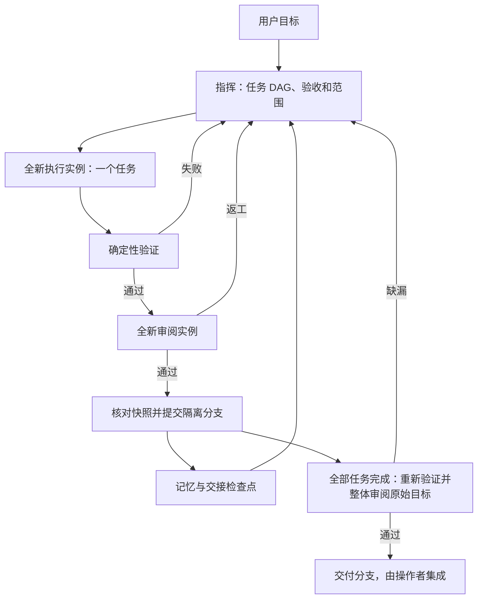

# Personal Harness

属于自己的多模型工程编排器。优先复用已登录的 Codex CLI 与 Claude Code，Python 3.11+，运行核心没有第三方 Python 依赖。当前为可运行的本地 CLI 首版，面向 macOS / Linux。

| 角色 | 默认模型 | 生命周期 |
| --- | --- | --- |
| 指挥 | `gpt-6-astra`，可切换 `claude-fable-5-2` | 通过持久任务台账延续决策，每次调用重新组装上下文 |
| 执行 | `claude-opus-5-5` | 一个任务或一次返工，一个新进程 |
| 审阅 | `gpt-6.1-sol` | 一次独立审阅，一个新进程 |

模型 ID 按配置原样使用；账号、模型权限或 CLI 故障直接报错，不自动换模型。每次调用都有新的进程和 `dispatch_id`，不恢复供应商会话、不启用原生子 agent、不自动合并。



## 先运行

在这个仓库目录中执行：

```bash
python3 -m harness doctor
python3 -m harness demo
python3 -m unittest discover -s tests -v
python3 tests/run_shards.py
```

`doctor` 只检查配置中使用的 CLI 安装和登录，不请求模型；`demo` 用模拟 agent 跑真实 Git、测试、提交、记忆和交接流程，在临时目录留下可检查的结果。它不证明真实模型调用成功。

单进程 `unittest discover` 是参考跑法。`python3 tests/run_shards.py [--shards 4] [--out DIR] [--pattern 'test*.py']` 用同样的标准 discovery 收集测试 ID，按模块分组在独立的 unittest 进程中并行运行，再从各组日志核对执行集合：收集到的每个测试恰好执行一次时才以 0 退出；收集到重复 ID、某组失败、模块导入失败、日志无法完整对账，或有测试缺失、重复、多出时都以非零退出并列出 ID。

真实模型的最小联调会消耗你现有账号的额度：

```bash
python3 -m harness smoke
python3 -m harness smoke --commander fable
```

`smoke` 在临时 Git 仓库完成一个小函数，由真实指挥生成计划，再调用执行者、任务审阅者和整体审阅者，并运行真实测试。它不改动本仓库代码。在 Claude Code 会话里运行时，会话的环境变量照常传给 CLI 子进程，建议在普通终端里运行。

独立权限与工具检查也调用配置中的真实 Claude worker 模型、消耗账号额度并保留原始证据：

```bash
python3 -m harness.permission_smoke --config /path/to/harness.toml --repo /path/to/project
python3 -m harness.tool_smoke --config /path/to/harness.toml --repo /path/to/project
```

权限检查在 `.harness/permission-smoke/` 建立专用现场，关闭外部 MCP，不执行项目验证命令；它不证明完整命令白名单或 OS 隔离。参数、证据要求和结果边界见[真实账号联调](docs/operations.md#真实账号联调)；离线验证、已完成的真实账号联调与仍然没有运行的项目见[验证记录](docs/validation.md)。

## 对自己的项目执行任务

1. 为目标项目准备 [harness.toml](harness.toml)，设置真正需要的 `verification.commands`，运行时显式传入 `--config`。每条命令是 argv 数组，不经 shell 解释，例如 `["uv", "run", "pytest"]` 或 `["npm", "test", "--", "--run"]`。依赖需要在 worktree 中可用；生成产物应已忽略或位于工作树外，验证期间出现未忽略的新文件也会触发快照门禁。
2. 目标项目必须有 Git 提交，且已跟踪文件与暂存区没有未提交修改。主检出的未跟踪文件只产生警告并保留原位；任务工作树从 HEAD 创建，不复制未跟踪或忽略文件。编排器不会替你 stash。当前不支持 submodule，索引存在 gitlink 时在创建 worktree 和派发模型前报错。
3. 在本 Harness 仓库目录运行：

```bash
python3 -m harness --config /absolute/path/harness.toml --repo /absolute/path/to/project run "修复分页边界错误，并补充必要的回归测试"
python3 -m harness --config /absolute/path/harness.toml --repo /absolute/path/to/project run "实现导出功能" --commander fable
```

未传入 `--config` 时使用本 Harness 仓库的默认配置，不会按 `--repo` 自动选择目标项目配置。`run` 启动时输出实际配置路径和验证命令。后续 `resume` 应使用同一份配置；共享资源路径相对于配置文件所在目录。

从 Harness 源码目录对任意项目执行时，`--config`、`--repo` 等全局参数必须写在子命令之前，路径使用绝对路径。先运行 `doctor` 核对回显的 `harness.package`、`harness.revision`、`config.sha256` 与 `shared` 路径，确认加载的是预期的包和配置，而不是同名模块或另一份安装。每次 `run`／`resume` 自动在目标项目 `.harness/operations/` 写一份操作记录，可用 `--operation-id ID` 指定 ID，同名记录已存在时拒绝。统一入口、外层 agent 的操作边界、记录与报告模板见[操作与观察](docs/operations.md)。

配置拒绝未知节和键，并指出完整路径。非 editable 安装不附带默认 `harness.toml` 与 `shared/`，执行任务需显式提供配置；`status`、`watch`、`dashboard`、`memory`、`prepare-run` 和 `cleanup-run` 不加载配置。运行事件和诊断写 stderr，`run`、`resume`、`demo` 的 stdout 保持单个 JSON 结果。

可用 `--plan /path/to/plan.json` 提供已有计划，格式见 [examples/plan.json](examples/plan.json)。输入在创建 run、分支和 worktree 前校验任务 ID、DAG、非空验收、范围和 skill。范围从仓库根目录匹配：`src/*` 只匹配直接子项，`src/**` 匹配所有层级，`**/*.py` 也匹配根目录文件；只有独立 `**` 路径段跨越 `/`。范围应覆盖必要测试与夹具。全仓库模式允许但会警告；`.git`、`.harness`、`.codex`、`.claude` 仍受保护。可用 `--scope PATTERN`（可重复）在启动前声明 run 的范围边界：只接受具体路径、字面子树 `p/…/**` 或 `**`；首版计划与之后每次修订新增的模式都必须能证明在边界内，`--plan` 越界时不创建 run。不声明时首版不受约束，修订只能复用已发布计划的模式。

任务的 `required_commands` 最多声明 32 条不同的完整 argv，表示执行前置条件，不授予权限。派发前与 `verification.commands`、`permissions.worker_commands` 精确比较；不接受前缀，`verification.setup_commands` 不授予 worker 能力。能被内置 [`git_query`](docs/operations.md#git_query) 解析的只读 Git 查询（例如 `["git", "ls-files", "-z", "--", "src"]`）算作已满足，无需授权；`self_checks` 按同样规则比较。缺少授权时不启动 worker 或消耗其尝试，其他满足条件的就绪任务仍可继续；已有任务选择保持绑定。`status RUN` 显示 `missing_command_requirements`，追加精确授权后普通 `resume` 即可重检，无需环境更新。计划批准不增加权限，检查不证明命令存在、执行成功或验收通过。

模型计划无效（含 `required_commands` 重复或超过 32 条、计划大到整体审阅的必要上下文超出 `context_chars`）时自动重做一次，仍无效则停止，普通 `resume` 重新请求。指挥与审阅读不出否决的无效输出都这样处理；worker 的无效输出计一次工作尝试后继续。规则与边界见[无效输出与自动重做](docs/recovery.md#无效输出与自动重做)及[阻塞出口](docs/recovery.md#阻塞状态与操作者出口)。

任务可另声明 `self_checks`（最多 32 条精确 argv）与 `evidence_requirements`（`id`、从 0 起的 `acceptance_index`、`kind`、仓库相对 `path`）。证据类型为 `static`、`simulation`、`host_integration` 或 `device`。角色收到 `verification_plan`，区分 worker 聚焦自检、全部正式任务门禁与最终门禁；自检不授权，也不替代正式验证。worker 无需默认重复全套门禁，仅在有明确诊断理由时重复。运行时按 `evidence_requirements` 直接检查候选中的文件并记录摘要，worker 不再声明证据；内容正确性仍由独立审阅核验。返工时，修复声明和审阅处置都使用运行时按本次必需问题生成的键 `f1…fN`，模型不回填来源与问题 ID；声明不证明修复，候选路径与普通 evidence 中的外部日志引用保持分开。

worker 可用结构化续作请求正常交还控制权，等待精确命令授权或单次派发超时调整；满足条件后以全新派发继续原候选，累计调用和任务预算保留。`resume RUN --execution-guidance FILE` 可在安全待处理任务边界登记绑定来源与候选的操作约束；指导不授予命令权限。格式与适用边界见[续作与操作指导](docs/recovery.md#续作与操作指导)。

续作请求中的命令或方案需要先修正时，使用 `resume RUN --reject-request FILE`（`{request_id, reason}`，`request_id` 取 `status RUN` 的 `continuation.request_id`）显式拒绝当前请求，保留候选交给同一任务的全新 worker。无需先授权旧命令或增加请求的超时；拒绝记录绑定原请求和候选，累计预算继续计算，新命令仍须独立授权。`status RUN` 提供请求绑定字段，输入格式与中断恢复规则见[续作与操作指导](docs/recovery.md#续作与操作指导)。

默认连续执行。需要先检查计划或分步执行时：

```bash
python3 -m harness --config /path/to/harness.toml --repo /path/to/project run "实现导出功能" --pause-after-plan --scope 'src/**' --scope 'tests/**'
python3 -m harness --repo /path/to/project status RUN
python3 -m harness --config /path/to/harness.toml --repo /path/to/project resume RUN --approve-plan --step
python3 -m harness --config /path/to/harness.toml --repo /path/to/project resume RUN --step
```

`RUN` 替换为实际 run ID。`--pause-after-plan` 等待显式 `--approve-plan`，普通恢复不会批准；`--approve-plan` 只批准已发布的首版，首版尚未发布时被拒。等待批准时 `status RUN` 的 `scope_summary` 按任务列出模式及其是否在边界内。`--step` 最多接受一个任务后暂停，最后一个任务完成后仍执行整体验收。

指挥的修订若只细化当前未接受任务的说明、追加它的范围或前置命令且仍选它，会核验并保留该任务的候选代码，交给同一任务的新 worker；新增任务或依赖仍先归档未接受修改。提案有模式无法证明在范围边界内时被持有（回执保留、不调用模型）：核对后执行停止信息给出的 `resume RUN --scope=…` 落地同一提案，或用 `resume RUN --reject-request FILE` 拒绝它。指挥提问后 run 停止，须通过 `resume RUN --operator-decision FILE` 明确回答；回答进入下一次指挥决定。详见[指挥提问、修订与范围](docs/recovery.md#指挥提问修订与范围)。

所有更改在 `<目标项目>/.harness/worktrees/<run_id>` 的 `harness/<run_id>` 分支完成。每个通过检查和审阅的任务生成本地提交。成功输出分支和路径，便于查看 diff、merge 或 cherry-pick；最终集成由你操作。

每个有改动的已接受任务恰好生成一个提交。提交消息由该任务的 worker 按目标仓库的提交规范撰写（`commit_message` 的主题与正文），经独立审阅审查；除非仓库规范要求，消息里不加 `Co-Authored-By` 之类的署名行，多出的署名行由审阅者按阻断问题退回；运行时按原样提交（`--cleanup=verbatim`），只在末尾追加 `Harness-Run`、`Harness-Task` 两行 trailer。作者与提交者固定为 `Personal Harness <harness@localhost>`，不签名，不运行仓库 hooks，提交编码固定为 UTF-8；运行时不推送、不合并、不改写历史。目标或仓库规则要求更多（签名、`Signed-off-by` trailer、指定作者、压缩提交、推送）时，指挥会向操作者提问，不会写成运行时做不到的验收项。

外层脚本按 trailer 识别 Harness 提交，不要匹配主题。读取时固定 trailer 分隔符，并让 `interpret-trailers` 不把正文里的 `---` 行当作补丁分隔线：

```bash
git -c trailer.separators=: log --format='%H %(trailers:key=Harness-Task,valueonly)' harness/RUN
git cat-file commit SHA | sed '1,/^$/d' | git -c trailer.separators=: interpret-trailers --parse --no-divider
```

## 验收与隔离

任务接受必须同时满足：合法 worker 结果声明完成（含合规的 `commit_message`）、Git 绑定与 HEAD 未变、修改在允许范围内、所有验证成功、独立审阅批准且无 blocking findings、接受前文件快照仍一致。建议可以保留，`request_changes` 或任何阻断问题都不通过。审阅者读取实际 diff、验证日志和历轮问题的证据，不接收 worker 的私有推理；worker 自报完成不等于接受。

全部任务接受并提交后重新运行验证，由新的审阅实例对照原始目标、原始任务约束和整条分支 diff 验收。整体拒绝须经正常修复任务门禁，不能靠反复恢复重抽审阅结论。记忆在任务接受后写入，知识提案还须逐项获批。

指挥只有一种调用 `decide`，每次返回 `implement`（选一个就绪任务并给出指令）、`revise`（首版计划，或对当前计划的增量修订并选出下一个任务）或 `ask`（向操作者提问并停止）之一；是否需要指挥决定由台账推导。返工时指挥可直接修订，缺少前置条件时补充任务，验收在当前边界内不可达时提问，无需先重复派发 worker。操作者接受风险不改变验收；停止后的部分交付与恢复出口见[验收不可达](docs/recovery.md#验收不可达)。

一条 run 按 DAG 串行执行，复用工作树和已接受代码。Git worktree 是任务隔离，不是操作系统安全沙箱；范围检查发生在接受前，忽略文件和外部服务副作用不在 Git 快照覆盖范围内。CLI、验证命令和 MCP 服务以当前用户权限运行。更强隔离需专用 OS 用户或容器。

需要验证交付提交不依赖 worker 留下的忽略文件时：

```toml
[verification]
commands = [["npm", "test", "--", "--run"]]
fresh_checkout = true
setup_commands = [["npm", "ci"]]
```

默认 `fresh_checkout = false`、`setup_commands = []`。开启后，仅整体验证改用目标仓库外的全新 detached worktree，顺序执行准备与验证；准备不得改变已跟踪文件或留下未忽略文件，也不授予 worker 权限。任务级验证仍在原工作树，依赖仍须可用。同一 run 不可改变这两项设置。

验证通过的检出由运行时在整体审阅派发前尝试回收；准备失败、验证失败或中断的检出保留供检查，用 `cleanup-run` 清理（见[整体验证与重验](docs/recovery.md#整体验证与重验)）。该模式仍使用当前环境、Git 配置及声明的准备命令，不承诺容器级可复现性。审阅包里的忽略清单只列路径（目录折叠、有界），不校验内容，不能替代全新检出。

## 状态、恢复与清理

```bash
python3 -m harness --repo /path/to/project status
python3 -m harness --repo /path/to/project status RUN
python3 -m harness --repo /path/to/project status RUN --full
python3 -m harness --repo /path/to/project watch RUN
python3 -m harness --repo /path/to/project dashboard --port 8765
python3 -m harness --config /path/to/harness.toml --repo /path/to/project resume RUN
python3 -m harness --config /path/to/harness.toml --repo /path/to/project abandon RUN
python3 -m harness --repo /path/to/project cleanup-run RUN
python3 -m harness --repo /path/to/project cleanup-run RUN --remove
python3 -m harness --repo /path/to/project cleanup-run RUN --remove-ignored
python3 -m harness --repo /path/to/project cleanup-run RUN --remove --remove-ignored
```

`status RUN` 显示任务、预算、待答决定、续作、范围边界、审阅轮次、停止投影 `stop`（类型、标题、出口命令与诊断摘录）和运行期间账号额度的观测变化 `quota`（字段见[通用规则](docs/recovery.md#通用规则)与[额度](docs/operations.md#额度)），`--full` 查看完整台账。失败的命令在 stderr 输出一行 `[harness-json] {"event":"stop",…}`，与 `status RUN` 的 `stop` 同一投影；它紧跟在 `harness: ` 开头的错误全文之后，前后还有别的行，外层脚本按前缀 `[harness-json] ` 与 `event` 为 `stop` 找这一行，不按行号（见[自动记录的字段](docs/operations.md#自动记录的字段)）。`resume` 使用保存的现场和全新 agent，不恢复供应商会话，也不清零累计预算；恢复时只能放宽的配置与可以任意调整的额度等待上限见[通用规则](docs/recovery.md#通用规则)，其余配置及共享资产必须一致。

**额度用尽时的进程内等待。** Claude 担任的角色（worker、`--commander fable` 的指挥、配置成 Claude 的审阅者）遇到额度用尽（`provider_quota/usage_limit`）时，默认在同一进程里等到额度快照给出的重置时刻再继续，单次最多 `runtime.quota_wait_max_seconds` 秒（默认 21,600，即 6 小时；0 关闭）。等待期间 run 仍是 `running`、持有运行锁（另一个 `resume`／`abandon` 得到 `busy/run_lock`），`status RUN` 的 `quota_wait` 显示等到何时；按 Ctrl-C 或 SIGTERM 取消（记为中断），之后普通 `resume`。没有等待时停止值的 `data.wait_reason` 写明原因。它不是恢复：进程被杀就不会自动继续。条件、醒来后的核对与取消方法见[额度等待](docs/recovery.md#额度等待)。

只有两个预算旋钮，各自计数不同的东西：

| 配置键 | 计数 |
| --- | --- |
| `max_attempts` | 每个任务的 worker 工作尝试；已完整校验的 environment／operator 阻断不计入 |
| `max_agent_dispatches` | 整个 run 的模型调用次数，包括指挥、worker、任务审阅、整体审阅和无效输出的重做 |

没有全 run 的 worker 尝试上限，计划任务数、修订次数和整体尝试次数也没有单独的上限：修订新增的任务各有自己的 `max_attempts`（默认 5），全局由 `max_agent_dispatches` 封顶；计划大小由整体审阅的必要上下文约束。模型调用数远多于任务数，例如一次 7 个任务的 run 用了 52 次模型调用。因派发上限停止时，停止信息和 `status RUN` 的 `remaining_model_calls` 给出“如果之后全部一次通过，至少还需 N 次模型调用”；N 是下界，不含指挥决定、返工和重做。`status RUN` 的 `budgets` 另给出 `work_attempts`（扣除豁免后的任务尝试：环境或操作者阻断，以及额度、限速、过载、认证四类供应商失败）和 `attempts_total`（各任务 worker 调用之和）。

`watch RUN` 用 macOS kqueue 或 Linux inotify 等待文件变化，只在观察结果改变时输出简短 JSONL；等待超时不重读台账。默认到阻塞、暂停、等待批准或终态后退出，`--follow` 可继续等待后续恢复。`watch RUN --state /path/to/.harness` 可以直接观察保留下来的运行证据，不要求该目录仍是 Git 工作树。不支持原生通知的平台会明确报错。观察值来自台账，不证明模型进程仍在工作。

状态和网页提供只读的返工提示 `convergence` 与审阅轮次 `review_rounds`，用于判断范围和方案复杂度，不增加预算、不启动恢复、不改变验收（规则见[观察网页用法与限制](docs/operations.md#观察网页用法与限制)）。

`dashboard` 在 127.0.0.1 启动只读观察网页，stdout 只打印访问地址，Ctrl-C 停止；与 `status` 一样不加载配置，不启动、恢复或修改 run，刷新不启动任何 CLI。台账记为 running 不等于进程仍在工作。页面、“预算与额度”标签、事件订阅与文件访问边界见[观察网页用法与限制](docs/operations.md#观察网页用法与限制)。

同一快照上的已保存阶段可复用：验证中断只重跑验证，审阅调用故障只新派发 reviewer，已封存的 worker 结果不重新派发。已返回的结果不重抽，读得出的拒绝、提问和阻断不会因恢复消失；worker 调用失败时当场判定，额度、限速、过载、认证失败不计工作尝试（仍计入 `max_agent_dispatches`），输出完整但解不出对象结果是一次无效交付（计一次尝试后继续）。判定与保存顺序见[设计：不变量](docs/design.md#不变量)，进程未确认退出、HEAD／Git 绑定异常或证据损坏时的出口见下表与[阻塞状态与操作者出口](docs/recovery.md#阻塞状态与操作者出口)。

| 情况 | 常用出口 |
| --- | --- |
| 等待计划批准（`plan_approval/initial_plan`） | `resume RUN --approve-plan` |
| 精确命令未授权（`missing_commands/*`） | 追加配置后普通 `resume RUN` |
| 续作请求需要先修正（`continuation/*`） | `resume RUN --reject-request FILE` |
| 已保存 worker 环境阻断（`environment/worker_blocked`） | 修复条件后 `resume RUN --environment-update FILE` |
| 供应商额度用尽、限速、过载或认证失败（`provider_quota/*`、`provider_failure/overloaded`、`provider_failure/authentication`） | 额度恢复或修复登录后普通 `resume RUN`；worker 的这次调用不计工作尝试；额度用尽时先看 `data.wait_reason`（为什么没有在进程内等待） |
| 等待用户决定 | 从 status 取 request ID，`resume RUN --operator-decision FILE`；可重复参数一次回答多项 |
| 指挥提问 | 从 status 取 request ID，`resume RUN --operator-decision FILE` 回答；回答进入下一次指挥决定 |
| 指挥提案越出范围边界，已持有（`scope_extension/revision`、`scope_extension/initial_plan`） | 核对 `gaps` 与建议后执行停止信息给出的 `resume RUN --scope=…`，或 `resume RUN --reject-request FILE`；都不重抽提案 |
| 最终验证普通非零退出（`operator_decision/answer_required`） | 指挥提问时修复环境后 `resume RUN --operator-decision FILE --reverify` 一次答复并重验；指挥决定尚未返回（如额度或服务中断）而环境已修复时，可显式 `resume RUN --reverify`（已返回的指挥决定存在时拒绝） |
| 模型派发上限用尽（`budget/agent_dispatches`） | 按 `remaining_model_calls` 的下界提高 `max_agent_dispatches` 后普通 `resume RUN` |
| 旧 dispatch 退出记录无法确认（`process_unconfirmed/*`） | 人工核实后 `resume RUN --confirm-exited DISPATCH_ID`；停止信息只列 `abandon RUN --confirm-exited …` 时（worker 已返回结果而未封存），确认之后只能放弃 |

退出码由停止类型决定：0 完成或暂停（含计划待批准），3 有文档化的出口，2 输入不被接受，1 证据、现场或 Harness 自身的问题，130 中断（见[退出码](docs/recovery.md#退出码)）。这些入口沿用原预算、范围、权限和接受条件，不能通用地丢弃已返回结果或拒绝。选项互斥见[恢复选项与互斥](docs/recovery.md#恢复选项与互斥)，各停止信息的出口见[阻塞状态与操作者出口](docs/recovery.md#阻塞状态与操作者出口)。环境更新严格 JSON 示例见[环境更新](docs/recovery.md#环境更新)，决定输入格式见[操作者决定](docs/recovery.md#操作者决定)。检查点只说明声明的输入未变且未过期，不代替验证或审阅（协议与限制见[检查点](docs/operations.md#检查点)）；操作者答复只允许对应问题继续，不增加命令权限。

`abandon RUN` 保留分支、工作树和证据并禁止恢复；它与 `resume` 一样先核验台账和加载时证据，这些证据损坏时同样被拒绝（见[证据损坏](docs/recovery.md#证据损坏)）。放弃不删除文件，移除工作树用之后的 `cleanup-run RUN --remove`。

`cleanup-run RUN` 是唯一的显式清理入口（验证通过的检出另由运行时在整体审阅前尝试回收）：默认预览，逐项列出保留的全新验证检出和分支工作树能否清理、被什么挡住，`--remove` 才逐项删除。分支工作树只在 `completed` 或 `abandoned` 时清理，其他状态报告 `retained`；工作树里被 Git 忽略的文件只在本次命令带 `--remove-ignored` 时随工作树删除（不带时报 `blocked`，`--remove-ignored` 单独使用是预览忽略清单）；验证检出里的忽略文件随检出删除。某项受阻不影响其余各项，只有出现 `blocked` 时退出码为 1。派发或命令子进程退出未确认时整条命令拒绝，核实后可加 `--confirm-exited DISPATCH_ID`。命令不改 run 状态，不删除分支、台账或运行证据；中断后重跑同一命令续做。各状态的含义、门禁与记录文件见[放弃与清理](docs/recovery.md#放弃与清理)。

台账版本为 18。台账只存摘要与引用，完整内容在 run 目录的不可变文件里；这些文件被删除、修改或换成符号链接时 `resume` 停止并保留现场（见[证据损坏](docs/recovery.md#证据损坏)）。已完成 run 的普通恢复返回保存结果。

只支持当前台账版本：其他版本的台账在各入口一律被拒绝（`台账版本 N 不支持（当前版本 18）`），运行列表只列出它的路径、版本和“不支持”。见[终态与其他版本的台账](docs/recovery.md#终态与其他版本的台账)。

## 共用 skills / MCP

共用源在 `shared/`，由运行时读取，避免为两个厂商维护两套业务规则：

| 文件 | 用途 |
| --- | --- |
| [shared/RULES.md](shared/RULES.md) | 所有角色的任务协议 |
| `shared/skills/*/SKILL.md` | 角色工作方式与可选业务技能 |
| [shared/mcp.json](shared/mcp.json) | 外部 MCP 服务的唯一配置源 |

协议说明放在 RULES 与角色 skill 里，每次派发都注入；包里只放数据、索引和现场事实，没有静态协议说明（包的构成见[设计：架构](docs/design.md#架构)）。

角色 skill 自动注入一次；计划的 `skills` 选择额外技能，不需要时用 `[]`。其他技能先加载目录，再通过 `skill_read` 按需读取。旧计划引用角色 skill 仍合法且不会重复注入；不会自动安装整个 ECC 技能目录。

内置只读 `harness` MCP 向三种角色提供记忆、技能、运行状态，文件工具 `file_sha256`、`json_check`、`file_diff`，以及按固定形式表执行只读 Git 查询的 `git_query`；表外 argv 不执行即报错，没有记忆写入工具。形式表、参数规则与输出字段见[角色工具参考](docs/operations.md#角色工具参考)。

worker 独有的 `harness_commands` MCP 提供 `list_commands`、`run_command({command_id})` 和 `delete_path({path})`。`run_command` 执行配置中的完整 argv，不能附加参数或覆盖 cwd、env，不经 shell 插值；`delete_path` 删除一个 HEAD 中已跟踪、在任务 `allowed_paths` 内的普通文件，不删目录、不移动文件，删除不能被接受门禁撤销。每次调用的 journal、receipt 和输出留在 dispatch 私有 `commands/`。规则与保证见[worker 命令与删除](docs/operations.md#worker-命令与删除)。

```toml
[permissions]
worker_commands = [["python3", "-m", "unittest", "tests.test_export", "-v"]]
```

字面 `*` 或换行由 broker 原样传递，但含这些字符的 argv 不生成 Bash 许可；其余已配置命令和只读前缀仍作为 Claude worker 的 CLI 层 Bash 许可存在，这些调用不留 broker 记录，应优先用 broker。管道或重定向须显式授权完整 `["/bin/sh", "-c", "固定脚本"]`；删除范围内的已跟踪文件用 `delete_path`，移动文件或删除目录、未跟踪文件须配置含具体路径的精确 argv（如 `rm`、`mv`）。不会自动组合命令、授权 `gh`／`ssh`／`curl` 前缀或跳过权限检查，不得用后台执行绕过 broker。必要命令被拒绝时 worker 应报告环境 blocker。当前 Codex 适配器只提供只读模式，配置 Codex worker 会提前报错。

外部 MCP 支持 stdio / HTTP 和按 `roles` 限制；指挥、审阅服务必须声明 `read_only = true`，由配置维护者核实。凭据只填写环境变量名称。示例见 [examples/mcp.json](examples/mcp.json)；OpenWiki 默认关闭，启用前需填真实路径并关闭 agent 写入能力。预检验证配置，不连接服务或证明凭据可用。

```bash
python3 -m harness sync --role worker
```

`sync` 生成 `.harness/generated/worker/claude.mcp.json` 和 `codex.mcp.toml`；正式 dispatch 使用各自配置，不覆盖用户 CLI 配置。Codex 使用 `--ignore-user-config`，依赖自定义 provider/base URL 的登录需先扩展适配器。生成的调用关闭个人原生 hooks 与自动记忆、关闭项目指令自动注入；只读角色的厂商差异见[设计：不变量](docs/design.md#不变量)。候选项目指令作为待审阅证据，不能改变目标、验收或权限。

## 记忆与上下文

SQLite 存在目标项目 `.harness/memory.sqlite3`，同一项目各 run 共享库，各自保留独立分支和工作树。记忆分为任务历史、获批知识和操作者事实；L0 标题、L1 摘要、L2 详情按相关性与时间检索，原始 diff、日志和结果按引用读取。任务历史摘要来自独立 reviewer，worker 只可提出待批准知识。

```bash
python3 -m harness --repo /path/to/project memory add \
  --key architecture.storage --title "数据库约定" \
  --text "项目使用 PostgreSQL，迁移通过 Alembic 管理。" \
  --source "docs/architecture.md"
python3 -m harness --repo /path/to/project memory search "数据库迁移" --level 1
python3 -m harness --repo /path/to/project memory search --key architecture.storage
python3 -m harness --repo /path/to/project memory read mem_实际ID
python3 -m harness --repo /path/to/project memory history architecture.storage
python3 -m harness --repo /path/to/project memory export > memory-backup.json
```

`memory add` 默认保存项目事实，`--run RUN` 保存仅用于该 run 的参考说明，查询也需相同 `--run`。key 在项目内全局唯一，版本替换须作用域一致，旧版本仍可 read/export。真正的继续／停止选择应使用 `--operator-decision`。所有记忆均为 `reference_only`，不授予权限或替代操作者决定。

需绑定文件依据时，在拥有该项目 `.harness` 的主检出使用 `memory add ... --source-file docs/architecture.md`，可重复指定，规范化去重后最多十个文件。文件须在同一次 HEAD 中已提交，且工作区原始字节与 Git blob 相同；不支持符号链接，也不执行换行或 Git 过滤器转换。`--source` 仍只是说明文字。`--run` 只限定作用域；不要把 `--repo` 指向 Harness 的 run 工作树，当前不会自动路由到主库。

`search QUERY` 使用本地词法匹配，正文之外也匹配可形成完整词项的 key、`knowledge:` 去前缀名称及来源路径；任务文本也使用这些规则自动召回。运行时生成的 `task:<run_id>:<task_id>` 不按 key 名称词法命中，应通过正文（任务标题与摘要）或精确 key 查找。已知名字时用 `search --key KEY` 原样等值查询，不裁剪空格、折叠大小写或归一化 Unicode。两种查询仍过滤失活、过期和不适用记录。`history KEY` 列出所有版本、来源状态和替代关系供审计，不恢复旧版或改变默认召回。

查询返回 `source_status`：`unbound` 未绑定、`matching` 声明来源匹配、`changed` 已变化、`unavailable` 不可用、`not_checked` 未完成核验、`invalid` 来源格式无效。原 `possibly_stale` 和原因列表保留；匹配不证明内容正确或来源已合入当前分支。较早 run 工作树核对主检出后来绑定的文件时，出现 changed/unavailable 是正常结果。

自动任务历史与知识默认 TTL 为 180 天，可通过 `[memory]` 的 `task_ttl_days`／`knowledge_ttl_days` 调整，0 表示不过期；操作者事实默认不过期。检索先排列优先参考，再排列来源变化、不可用、非法或原因未知的需复核记录，组内保留相关性、时间、类型和原有过时降权。未绑定／未核验记录不额外降组，放弃或来源无效的任务历史不自动召回；来源 run 的台账不是当前版本（`source_run_status` 为 `unsupported`）时，它的任务历史也不再召回，记录本身不删除，获批知识与操作者事实不受影响。默认六条仍不能保证某条声明必然进入上下文；必要要求应写入任务验收。没有 embedding 或自动语义冲突合并。

上下文采用结构化检查点、有界检索和原始证据引用，在任务边界写 `handoff.json`；每次指挥调用重新构建输入。worker 结果的 `summary` 最多 32,000 字符，blocker、evidence、finding 等其余自由文本字段仍为 4,000；后续输入只带截取的摘录和全文的路径与 SHA256。环境阻断的停止信息只带 blocker 与 summary 合计至多 2,000 字符的摘录，并给出原 worker 结果的路径与 SHA256。默认 `context_chars = 100000` 是编排输入字符上限，不是 token 数；必要约束超限就停止，可选记忆按整条移除。CLI 内部上下文不在该预算内。

实际派发的 `context-report.json` 记录角色、阶段、必要字符数及字段尺寸，容器开销包含 JSON 键、引号与分隔符。成功派发的报告保留根与顶层字段尺寸及最大的 30 个嵌套字段，并在 `field_sizes_omitted` 给出省略数；必要输入超限时也保存报告且保留全部字段明细，不启动模型或扣调用预算。较长的续作历史、操作指导与重复命令通过 `input-indexes/` 中的不可变摘要索引检索；当前等待条件及指导义务仍保留，索引不授予命令权限。

dispatch 私有 `context-report.json` 中的 `memory_retrieval` 记录候选、匹配、作用域、数量上限与容量筛选计数。最多四十条明细，依次优先保留返回项、数量上限排除项、作用域排除项和未匹配项，并按实际 ID 标记装入情况；计数完整，明细不保证涵盖全部排除项。报告不加入模型提示词。

大量变更路径与恢复路径使用 SHA256 绑定的完整索引，按需检索，不重复塞进模型输入。相同清单共用索引，原始范围、验收、diff 与快照仍保留；索引缺失或损坏会阻止继续，不能靠截断路径绕过门禁。

默认 `agent_timeout_seconds = 3600`、全局 `claude_max_turns = 50`。可用 `claude_max_turns_by_role` 为单次 Claude 派发设置角色覆盖；仓库示例给 worker 200 轮，未列角色沿用全局值，旧配置不自动增加。它是工具使用循环的资源保护，一轮可有多个工具调用，不是任务累计工具次数，也不表示验收进度。Codex 不使用此参数；供应商的 `num_turns` 仅供观测，不能直接比较判定到限。

```toml
[runtime]
claude_max_turns = 50
claude_max_turns_by_role = { worker = 200 }
```

覆盖键只接受 `commander`、`worker`、`reviewer`，值必须为正整数；Fable 指挥使用 `commander` 的值。200 是长任务的起始配置，需结合到限率、最终验收和恢复重复工作调整，不保证任意任务都能完成。恢复只允许保持或提高各角色实际生效的上限；移除覆盖也会检查回退后的值。

超时是整次模型调用的墙钟时限，持续产出不会自动延长。轮数耗尽或超时的 worker 消耗一次工作尝试，已写修改及错误证据保留供恢复核对；增加容量不会清零任务、总调用或派发预算。完整输入和 `context-report.json` 保存在 dispatch 目录。

## 数据与排查

运行数据都在目标项目的 `.harness/` 下：台账 `runs/<run_id>/state.json`、事件、派发产物、验证日志、操作记录与额度样本，代码在 `worktrees/<run_id>/`。完整布局见[文件布局](docs/operations.md#文件布局)，操作记录的字段见[操作记录与记录模板](docs/operations.md#操作记录与记录模板)。

首次私有写入前，运行时保留 Git 公共目录 `info/exclude` 原字节并补充 `/.harness/`，同时建立私有根 `.harness/.gitignore` 的 `*` 保护；不改项目已跟踪 `.gitignore`。已有冲突控制文件、符号链接或被跟踪的私有状态会拒绝，不覆盖现场。`.harness/` 属于被忽略的私有运行目录，不要提交运行现场、凭据或生成 MCP 配置；日志可能包含代码与业务内容。

`status RUN --full` 的 `provider_usage` 及 `dispatch_finished` 事件记录供应商实际返回的用量，缺失用量不当作零，不汇总（见[用量与名义费用](docs/operations.md#额度)）。长进程每 60 秒在 stderr 提示仍在运行，实际超时独立生效。错误、中断、Git 提交与检查点之间的窗口见[不能自动恢复的窗口](docs/recovery.md#不能自动恢复的窗口)；派发事件的含义见[观察网页用法与限制](docs/operations.md#观察网页用法与限制)，调用计数以台账 `invoked` 为准。

## 参考与边界

[设计取舍与参考来源](docs/design.md)记录 Orca、ECC、OpenWiki 的借鉴及厂商接口依据；实现是独立的小型编排核心，未复制这些项目源码或运行其安装脚本。当前没有接管 Orca、安装全部 ECC 插件或部署 OpenWiki 图数据库。

[验证记录](docs/validation.md)记录当前版本已完成的离线验证与真实账号联调，并列出仍然没有运行的项目；[设计](docs/design.md)记录架构、不变量、状态转换与限制，[恢复与操作者出口](docs/recovery.md)列出停止后的处理。一条 run 串行执行；并行需要每任务 worktree、依赖集成与冲突处理，没有实现。

### 计划审阅、依赖准备与单次监督

复杂任务可先 `run "目标" --pause-after-plan`，用 `status RUN --full` 核对保存的计划后再 `resume RUN --approve-plan`：

```bash
python3 -m harness --repo /abs/project prepare-run RUN --manifest /abs/inputs.json
python3 -m harness --config /abs/config.toml --repo /abs/project supervise -- run "目标" --pause-after-plan
python3 -m harness --repo /abs/project cleanup-run RUN --remove --remove-input-copies
```

`prepare-run` 仅在暂停/等待批准且无未消费阶段的边界准备清单指定的不可变依赖。它不导入需要修改的源代码。`cleanup-run --remove-input-copies` 仍为预览，必须同时 `--remove` 才删除登记且未修改的副本；源文件和其他忽略文件保留（加 `--remove-ignored` 时其他忽略文件随工作树删除；`--remove-ignored` 不能代替 `--remove-input-copies`）。清单与恢复规则见 [操作说明](docs/operations.md#依赖副本清单)。

`supervise` 只启动一次指定的 Harness `run`/`resume`，保留子进程 stdout，监督回执写入 `.harness/supervision/` 并输出到 stderr，退出码等于子进程退出码；不会重启或自动恢复。父进程退出仍不证明 broker 子进程退出。要在 run 停下时得到提示，用 `watch RUN`（到阻塞、暂停、等待批准或终态时退出）或 `supervise`。

Claude 调用只用 JSON 输出（`--output-format json`），终态只从派发目录的 `process.stdout` 读取；错误、缺失或损坏的终态及非零退出均不能接受。观察不到的读取范围或拒绝原因保持未知。只读 `permission-diagnostics RUN DISPATCH --argv-json '["python3", "-m", "unittest"]'` 对比供应商拒绝证据和当前配置中的精确命令能力，并在 `builtin_coverage` 中单独说明该 argv 是否由内置 `git_query` 覆盖；它不执行命令或扩大权限。`status` 和 dashboard 同时显示预算的已用/上限/剩余与调用、审阅候选、失败、无效输出等独立维度。
