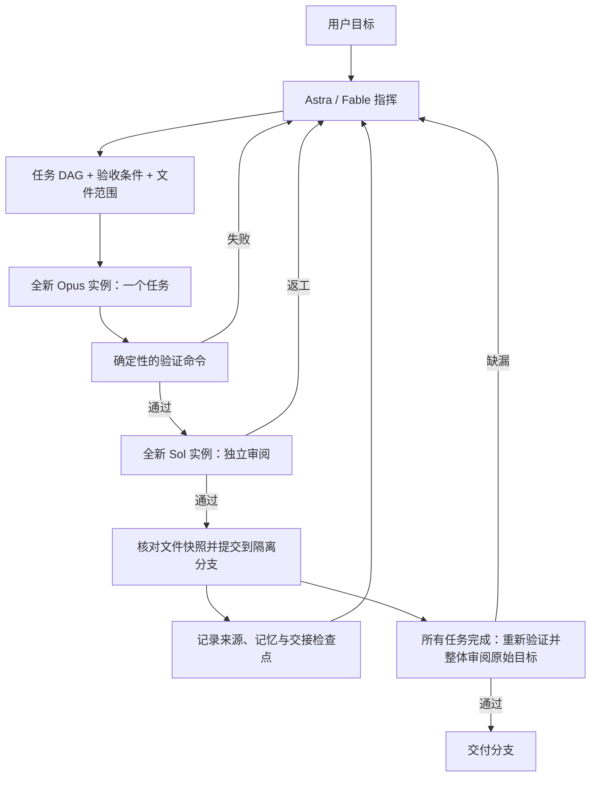

# Personal Harness

属于自己的多模型工程编排器。优先复用已登录的 Codex CLI 与 Claude Code，Python 3.11+，运行核心没有第三方 Python 依赖。当前为可运行的本地 CLI 首版，面向 macOS / Linux。

| 角色 | 默认模型 | 生命周期 |
| --- | --- | --- |
| 指挥 | `gpt-6-astra`，可切换 `claude-fable-5-1` | 通过持久任务台账延续决策，每次调用重新组装上下文 |
| 执行 | `claude-opus-5-5` | 一个任务或一次返工，一个新进程 |
| 审阅 | `gpt-6.1-sol` | 一次独立审阅，一个新进程 |



## 先运行

在这个仓库目录中执行：

```bash
python3 -m harness doctor
python3 -m harness demo
python3 -m unittest discover -s tests -v
```

`doctor` 只检查安装和登录，不请求模型；`demo` 用模拟 agent 跑真实 Git、测试、提交、记忆和交接流程，在临时目录留下可检查的结果。它不证明真实模型调用成功。

真实模型的最小联调会消耗你现有账号的额度：

```bash
python3 -m harness smoke
# 可选：改由 Fable 指挥
python3 -m harness smoke --commander fable
```

`smoke` 在临时 Git 仓库完成一个小函数，由真实指挥生成计划，再调用执行者、任务审阅者和整体审阅者，并运行真实测试。它不改动本仓库代码。

## 对自己的项目执行任务

1. 在 `harness.toml` 配置目标项目真正需要的 `verification.commands`。每条命令是 argv 数组，不经 shell 解释。例如 Python 项目可以使用 `["uv", "run", "pytest"]`，Node 项目可以使用 `["npm", "test", "--", "--run"]`。依赖需要在 worktree 中可用。
2. 目标项目必须有 Git 提交，且工作区干净。编排器不会替你 stash 尚未提交的工作。
3. 在本 Harness 仓库目录运行：

```bash
python3 -m harness --repo /absolute/path/to/project run "修复分页边界错误，并补充必要的回归测试"
python3 -m harness --repo /absolute/path/to/project run "实现导出功能" --commander fable
```

配置路径可以显式指定：`--config /absolute/path/harness.toml`。共享资源路径相对于该配置文件所在目录。自定义配置请使用正确的相对或绝对资源路径。

可用 `--plan /path/to/plan.json` 提供已有计划，格式见 [examples/plan.json](examples/plan.json)。计划会检查任务 ID、依赖环、非空验收条件与文件范围。唯一就绪任务在首次尝试且没有反馈时直接使用完整任务简报派发；存在选择或返工反馈时才调用指挥。

默认连续执行。需要先检查计划或分步执行时，可显式选择：

```bash
python3 -m harness --repo /path/to/project run "实现导出功能" --pause-after-plan
python3 -m harness --repo /path/to/project status run_实际ID
python3 -m harness --repo /path/to/project resume run_实际ID --approve-plan --step
python3 -m harness --repo /path/to/project resume run_实际ID --step
```

`--pause-after-plan` 将计划保存到运行目录并等待 `--approve-plan`；普通 `resume` 不会替你批准。`--step` 最多接受一个任务后暂停；最后一个任务完成后仍执行整体验收。

所有更改在 `<目标项目>/.harness/worktrees/<run_id>` 的 `harness/<run_id>` 分支完成。每个通过检查和审阅的任务生成本地提交。成功输出分支和路径，便于查看 diff、merge 或 cherry-pick。最终集成由你操作。

```bash
python3 -m harness --repo /path/to/project status
python3 -m harness --repo /path/to/project status run_实际ID
python3 -m harness --repo /path/to/project resume run_实际ID
```

`resume` 使用已有台账、代码现场和新的 agent 继续，不恢复供应商会话。任务次数、总 worker 尝试次数和再规划次数均不会因恢复而清零。可以调大 `context_chars`、两种超时、`claude_max_turns`、`max_attempts` 和 `max_total_attempts` 后恢复，变更会写入事件；其余配置和共享资源必须一致。旧进程组仍存活或 Git HEAD 与检查点不一致时停止恢复。账号授权/模型权限失败直接报错，不自动换成其他模型。

当前运行台账为版本 2，旧版台账可通过 `status` 查看，不能直接恢复执行；请用旧版本完成旧 run，或从核对后的代码开始新 run。

任务因缺少前置工作而返回 `blocker_kind=task` 时，指挥可进行有限再规划；权限、工具、账号或服务问题使用 `environment` 并停止。再规划保留所有现有任务 ID、验收条件和文件范围，已接受任务完全不变，可增加现有范围内的前置任务或修复任务。重新分配前，运行时归档未接受的修改并恢复到最后接受的提交。`max_attempts` 是每任务累计上限，`max_total_attempts` 是整个 run 的 worker 上限，`max_replans` 是再规划上限；达到上限不会通过改名刷新预算。

## “一个 agent 只做一件事”如何落实

- 每次调用生成唯一 `dispatch_id`，返回结果必须同时匹配它和 `task_id`。
- Claude 使用 `--no-session-persistence`，Codex 使用 `--ephemeral`，没有 resume/continue。
- 禁用原生子 agent；指挥通过结构化计划交给调度器启动执行者。
- 返工使用新进程，得到同一任务、验收条件和必要的失败反馈。
- 审阅者收到任务、实际 diff、验证日志和历轮审阅问题的证据引用，不注入执行者的私有推理。记忆提案作为待独立核实的数据传入。
- 一条 run 按 DAG 串行执行，复用该 run 的工作树和已经通过审阅的代码；不复用执行者的模型会话。
- 任务接受由“检查通过 + 审阅通过 + 文件快照未变”决定。结构化 findings 区分阻断问题与建议；建议可以保留，`request_changes` 或任何阻断问题都不通过。
- 全部任务接受后重新运行验证，由新的审阅实例对照原始目标、原始任务约束和整条分支 diff 验收。整体拒绝后须经新修复任务通过门禁，不能靠反复恢复抽取新的审阅结论。
- 记忆写入只发生在任务接受之后；项目知识还需审阅者单独批准具体提案。

这是任务和会话层面的隔离。Git worktree 不是操作系统安全沙箱；文件范围检查是接受前的检查，不能保证恶意进程无法触碰同一用户可访问的其他文件。忽略文件、外部服务副作用不在 Git 快照覆盖范围内。

## 共用 skills / MCP / hooks

共用源在 `shared/`，由运行时读取，避免为两个厂商维护两套业务规则：

| 文件 | 用途 |
| --- | --- |
| `shared/RULES.md` | 所有角色的任务协议 |
| `shared/skills/*/SKILL.md` | 指挥、执行、审阅的工作方式；可增加业务技能 |
| `shared/mcp.json` | 外部 MCP 服务的唯一配置源 |
| `shared/hooks.json` | 确定性的编排生命周期 hooks |

当前角色 skill 直接注入；其他技能先加载目录，再通过内置 MCP `skill_read` 按需读取。任务计划中的 `skills` 可显式选择需要注入的技能。这里没有自动安装整个 ECC 技能目录。

内置 stdio MCP 在两种 CLI 中提供相同工具：

- `memory_search` / `memory_read`：项目记忆与来源。
- `skill_list` / `skill_read`：共用技能。
- `run_status`：当前目标与已接受任务。

`shared/mcp.json` 支持 stdio 与 HTTP。外部服务可按 `roles` 限定可见性；指挥和审阅服务必须声明 `read_only = true`，该声明由配置维护者负责核实。外部服务需要的凭据只填写环境变量名称。完整示例见 [examples/mcp.json](examples/mcp.json)，其中 OpenWiki 默认关闭，需要填入真实路径，并确保它没有开启 agent 写入能力。

```bash
python3 -m harness sync --role worker
```

这会生成 `.harness/generated/worker/claude.mcp.json` 和 `codex.mcp.toml`，供检查或手动使用；每次正式 dispatch 也会生成并传入自己的 MCP 配置。不会覆盖 `~/.claude` 或 `~/.codex` 的配置。Codex 调用使用 `--ignore-user-config` 保留登录凭据并减少个人配置干扰；如果你的登录依赖自定义 provider/base URL，当前适配器需要先显式扩展后才能复用该配置。

统一 hooks 是**编排生命周期 hooks**，覆盖 `pre_agent`、`post_agent`、`pre_verify`、`post_verify`、`pre_accept`、`post_accept`、`context_prepared`、`on_error`。例如：

```json
{
  "pre_accept": [
    {"argv": ["python3", "scripts/check_policy.py"], "timeout_seconds": 30}
  ]
}
```

脚本工作目录是配置所在目录，从 stdin 读取 JSON 事件，非零退出码阻止继续。通过事件中的路径定位目标项目。默认空数组表示没有额外策略。`context_prepared` 表示已组装有界输入；旧名 `context_compacted` 仍可单独配置作为别名，不能与新名同时配置非空脚本。它们与厂商原生的 `PreToolUse`、`PostToolUse` 不是同一层；运行时不截获所有原生工具调用。生成的调用会关闭个人原生 hooks/自动记忆，避免重复采集；企业管理配置可能仍有更高优先级。

`post_accept` 失败时保留已接受提交及待完成的 hook；恢复会先重试该 hook，成功前不能执行下一个任务或完成 run。hook 在成功后、检查点写入前中断时可能再次执行，需要将外部副作用写成可重复执行的操作。

Claude worker 显式允许读写工具、部分读取命令和配置的验证命令。Claude 指挥与审阅角色也可使用受限的 Git 查询命令；输入包列出可用命令示例。额外的 worker 命令通过配置声明为完整 argv：

```toml
[permissions]
worker_commands = [["python3", "-m", "unittest", "tests.test_export", "-v"]]
```

额外命令不接受 `*` 或换行。验证 argv 中的字面 `*` 仍可由确定性验证器执行，但不转成 Bash 授权，以免被 CLI 解释为权限通配符。不使用跳过所有权限检查的参数；CLI 自身仍可能允许内建只读命令，这些授权不是操作系统沙箱。必要命令被拒绝时，worker 应报告环境 blocker。当前 Codex 适配器只提供只读模式，因此配置 Codex worker 会提前报错。目标项目的原生规则与 CLI 自动加载内容仍可能影响模型，32,000 字符预算仅覆盖编排器生成的输入包。

## 记忆与压缩

首版将三种状态分开：

| 层 | 内容 | 读取方式 |
| --- | --- | --- |
| 必要工作状态 | 用户目标、当前任务、验收、范围、依赖、失败反馈 | 每次完整传递，超预算就报错，不静默裁掉约束 |
| 长期记忆 | 通过验证与审阅的任务结果、你显式输入的知识 | L0 标题 / L1 摘要 / L2 详情，按相关性和时间检索 |
| 原始证据 | diff、测试输出、结构化结果、进程日志、提交 | 文件落盘，摘要保留引用，可按需读取 |

SQLite 存在目标项目 `.harness/memory.sqlite3`，项目之间独立。每条记忆保存来源、时间、类型和版本。相同 `key` 的新记录替代旧记录的默认检索资格，旧记录仍可按 ID 查询。支持 TTL。系统不会自动猜测两条不同 key 的事实是否矛盾。

任务历史仍使用 `task:<run_id>:<task_id>`，保留每次已接受结果。worker 可另行返回 `proposed_memories`，每条包含稳定 key、摘要、事实内容和仓库来源文件；审阅者通过 `approved_memory_keys` 单独批准。运行时将通过检查的提案写入 `knowledge:` 命名空间，并保护操作者维护的记录。代码通过不代表所有记忆提案通过，agent 没有直接写记忆的 MCP 工具。

自动任务记忆与项目知识默认 TTL 均为 180 天，可用 `[memory]` 的 `task_ttl_days`、`knowledge_ttl_days` 配置，设为 0 表示不过期。操作者手写事实默认不过期。项目知识保存提交和来源文件哈希；检索时来源变化会标记 `possibly_stale` 并降权，保留原记录供查证。类型权重帮助项目知识和手写事实优先于同等相关的任务流水，但不能替代对当前代码的核对。

```bash
python3 -m harness --repo /path/to/project memory add \
  --key architecture.storage --title "数据库约定" \
  --text "项目使用 PostgreSQL，迁移通过 Alembic 管理。" \
  --source "docs/architecture.md"
python3 -m harness --repo /path/to/project memory search "数据库迁移" --level 1
python3 -m harness --repo /path/to/project memory read mem_实际ID
python3 -m harness --repo /path/to/project memory export > memory-backup.json
```

检索是支持英文词项和中文二元词的本地词法排序，含时间衰减；没有把它称为 embedding / GraphRAG。`memory export` 输出包含历史版本的 JSON，便于备份或迁移。

上下文压缩采用**结构化检查点 + 有界检索 + 原始证据引用**：在任务边界写 `handoff.json` / `handoff.md`，下一次指挥重新构建输入。不会将越来越长的对话摘要反复摘要。可选记忆按整条移除，必要约束完整保留。单个 CLI 内部的长任务压缩仍由 CLI 管理，编排器不操作模型私有 KV cache。

所有输入包与预算报告落在 dispatch 目录。默认 `context_chars = 32000` 是字符预算，不是假称的精确 token 数。

## 数据与排查

```text
<project>/.harness/
  memory.sqlite3
  generated/
  runs/<run_id>/
    state.json          # 任务台账、当前尝试、进程组、分支
    events.jsonl        # 追加事件
    handoff.json / handoff.md
    dispatches/<uuid>/ # prompt、schema、结果、CLI stdout/stderr
    verification/      # 实际命令、退出状态、输出、diff
  worktrees/<run_id>/   # 独立分支中的代码
```

运行时只把 `/.harness/` 加入目标项目的本地 `.git/info/exclude`，不更改其已跟踪 `.gitignore`。日志可能包含代码和业务内容，按你的项目数据要求保管。

超时会停止该次调用的进程组，Ctrl+C 会保留检查点。若进程在 Git commit 与检查点写入之间被强制杀死，恢复会因 HEAD 不一致而拒绝自动重放；先核对包含 `Harness-Run` / `Harness-Task` 的提交。首版不提供自动“修复”状态文件的危险捷径。

## 参考与边界

设计参考记录见 [docs/design.md](docs/design.md)。实现是独立的小型编排核心，未复制这些项目的源码，也未运行它们的安装脚本。
已执行的离线与真实模型验证见 [docs/validation.md](docs/validation.md)。

- Orca：借鉴 Run / Task / Dispatch 和明确完成状态；当前没有接管 Orca 桌面窗口或消息队列。
- ECC：借鉴共享源、薄适配器、阶段交接和按需技能；当前未引入它的全部插件和自动学习系统。
- OpenWiki：参考记忆、来源、版本替换与交接；当前没有部署它的图数据库或 LLM 检索管线，可经外部 MCP 接入。

后续可在现有测试约束下扩展：每任务独立 worktree 的并行调度、Orca 可视化适配、embedding 混合检索、记忆整理与冲突候选审查。首版先保证完整串行闭环和新会话边界。
